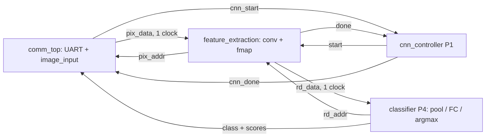

# Hardware — Basys 3

Panduan port, aritmetika dan verifikasi subsistem.
[Perintah tes dan susunan testbench](../tests/README.md).

## Modul RTL

| Kelompok | Modul | Pemilik |
|---|---|---|
| Feature extraction | rtl/feature_extraction/: conv, ROM, requant, fmap dan wrapper feature_extraction | P3 |
| Komunikasi | rtl/communication/: UART RX/TX, frame controller dan wrapper comm_top | P5 |
| Input | rtl/input/image_input.v: live RAM dan stored ROM | P5 |
| Classification | rtl/classification/: maxpool2d, FC, argmax dan wrapper classifier | P4 |
| Control | rtl/control/: cnn_controller dan cnn_core | P1 |
| Board | rtl/top/top_basys3.v, rtl/board/: tombol dan seven-segment | P1/P4 |

[Tes P3 dan sintesis](../tests/README.md#p3-feature-extraction) · [Tes P5 dan dummy top](../tests/README.md#p5-komunikasi).
Nama modul dan port lama dipertahankan. Path dikelompokkan per fungsi; semua
source produksi tercatat di rtl/files.f, dibaca runner dan rtl/read_sources.tcl.
Implementasi controller, pooling, FC, argmax, display dan top/XDC tersedia
di main. Jalur CNN lengkap LIVE telah diuji fisik pada 3 November 2026;
hasil dan batas bukti dicatat di bagian akhir panduan ini.

## P3 feature extraction

Owner: Mahardika (P3). Buddy: Kania Ika (P4). P3 owns the convolution layer, from the input-image read port to the 1,568 activations in `fmap_ram`.

The arithmetic is P2's integer contract (`reference_model/README.md`), and the weights and biases are P2's files. The current model is p2-doc-int-v2, in `reference_model/models/p2-doc-int-v2/`, with its golden model in `reference_model/document_v2/golden.py`. The older p2-int-v1 still runs, with a 32-bit accumulator.

### Files

| File | What it is |
| --- | --- |
| `rtl/feature_extraction/feature_extraction.v` | Production P3 wrapper: convolution and feature memory with a public synchronous read port |
| `rtl/feature_extraction/conv_engine.v` | 3×3 convolution, 8 filters, 1 multiply-accumulate per cycle, `ACC_W`-bit accumulator (24 by default); contains `conv_wrom` and `requant_relu` |
| `rtl/feature_extraction/conv_wrom.v` | The 72 weights and 8 biases in LUTs, 1-cycle reads, loaded from P2's `conv_weight.mem` and `conv_bias.mem` |
| `rtl/feature_extraction/requant_relu.v` | `q = min(127, (max(0, acc)*M + 2^(S-1)) >> S)` in 48 bits, 2-cycle pipeline |
| `rtl/feature_extraction/fmap_ram.v` | 1,568-byte simple dual-port block RAM: `conv_engine` writes, `maxpool` reads |
| `tests/rtl/p3/conv_engine_tb.v` | `conv_engine` + `fmap_ram`; checks all 1,568 accumulators and all 1,568 activations of each image bit-exact |
| `tests/rtl/p3/requant_relu_tb.v` | 10,000 accumulator values per (M, S, width), checks the result, order and latency |
| `tests/rtl/p3/p3_vectors.py` | P3's own integer reference of the conv layer, and P3's test vectors |
| `tests/rtl/p3/p2_vectors.py` | Tests from P2's packages: their own golden vectors, or P2's golden model when a package has none |
| `tests/rtl/p3/run_p3_tests.py` | Runs everything and prints PASS/FAIL |
| `tests/rtl/p3/synth_p3.tcl`, `tests/rtl/p3/p3_synth_top.v` | Out-of-context synthesis, place and route of the block, for timing, resources and power |
| `tests/rtl/p3/conv_engine_tb.gtkw` | GTKWave layout for the engine's waveform: signals grouped by pipeline station |

### Running the tests

```powershell
python tests/rtl/p3/run_p3_tests.py                                   # Icarus Verilog
python tests/rtl/p3/run_p3_tests.py --sim xsim --vivado-bin C:/Xilinx/Vivado/2019.1/bin
python tests/rtl/p3/run_p3_tests.py --vectors path/to/package          # on one P2 package outside the repository
python tests/rtl/p3/run_p3_tests.py --wave                             # also save waveforms (.vcd)
gtkwave build/p3_sim/iverilog/p2-doc-int-v2/conv_engine_tb.vcd tests/rtl/p3/conv_engine_tb.gtkw
```

Vectors, logs and simulator files go to `build/p3_sim/`, which Git ignores. The P2 tests need NumPy and Pillow, as in P2's `reference_model/requirements.txt`. Missing dependencies, missing model packages and packages without input images make the run fail; an empty test selection never counts as success.

Run the runner's regression checks with standard-library unittest:

```powershell
python -m unittest discover -s tests/rtl/p3 -p test_run_p3_tests.py
```

The refactor suite has 23 tests: the original 20, two production-wrapper
readback tests (v2 int24 and v1 int32), and a P5 stored-input -> P3 integration
test on all 16 stored pictures. The original 20 previously passed Icarus and
Vivado 2019.1; the expanded suite is checked with Icarus.

- `conv_engine_tb` on p2-doc-int-v2's own 25 golden vectors: 20 validation pictures and P2's 5 synthetic inputs. The engine is compiled with no parameters (`P2_DEFAULTS`), as a top that passes none, so this test also checks that its defaults are P2's current model.
- `conv_engine_tb` on p2-int-v1, whose package has no vectors: 20 pictures (P2's example of each class, the 5 synthetic inputs and 7 random pictures) checked against v1's `golden.py`, with `ACC_W` = 32.
- `conv_engine_tb` on P3's random model (20 images), and on the accumulator limits and an overflow that must be flagged, each at 24 and 32 bits.
- `requant_relu_tb` with 10,000 values for each of 13 cases: 11 (M, S) pairs from S = 0 to 47 at 24 bits, including P2's (43980, 25) and (34172, 25), and 2 at 32 bits.

Before the P2 tests, the runner checks P2's checksums, that the `.mem` files hold the same numbers as `parameters.npz`, and that P3's own reference gives every accumulator and activation P2 expects.

What the tests show about p2-doc-int-v2: filter 2 can never fire. Even with 255 under each of its positive weights it reaches only −538, so its activations are always 0. The other 7 filters all fire on the real pictures; filter 3, which never fired on v1's class examples, now fires on 74% of its outputs. No activation is clipped (none of the 39,200 reaches 127), and the largest accumulator is 95,531, far inside 24 bits.

`conv_engine_tb` compares in the order P2's handoff asks for: each of the 1,568 accumulators as it finishes, then each activation read back from `fmap_ram`. The accumulators catch errors the rescale can hide: a planted bug that gave 7 outputs per picture the wrong bias changed 140 accumulators but only 67 activations. Every bug planted on purpose has been caught: 13 in the 32-bit version, then 7 more for the 24-bit version, including a 32-bit default reading v2's 6-digit biases (29,400 wrong accumulators).

`--vectors DIR` runs the core/wrapper tests (and stored-input integration when available) on one P2 package folder outside the repository, such as a new export: `contract.json`, `mem/`, and `vectors/<name>/` with `input.mem`, `conv_acc.mem` and `activation.mem`, as P2's export writes them.

With `--wave`, each test also saves a waveform next to its log. `conv_engine_tb` records one picture's run and read-back (picture 3 by default, about 6 MB; set `DUMP_IMG` to pick another). In p2-doc-int-v2's vectors, picture 3 is a Yield sign. GTKWave comes with Icarus Verilog; the `.gtkw` layout opens at the start of the run. The first result is stored at the end of tick 14, and `done` rises at tick 14,117.

### Synthesis

```powershell
vivado -mode batch -nojournal -log build/p3_synth/vivado.log -source tests/rtl/p3/synth_p3.tcl
```

Run it from the repository root in the Vivado Tcl Shell, or with Vivado's `bin` folder on PATH. It uses p2-doc-int-v2's weights and biases unless you pass another 24-bit set with `-tclargs`. The results below are out of context on the XC7A35T (`xc7a35tcpg236-1`) after place and route. The historical rows use Vivado 2019.1; the refactor row uses Vivado 2026.1, so resource differences are not evidence of an RTL optimization. The run assumes `pix_data` arrives 3 ns after the clock (P5's block RAM plus `input_mux`) and `pix_addr` must leave 2.5 ns before it:

| Version | Timing at 100 MHz | LUTs | Flip-flops | Block RAM | DSP48E1 | Dynamic power |
| --- | --- | --- | --- | --- | --- | --- |
| Refactor, p2-doc-int-v2 (3 November, Vivado 2026.1) | Met, 3.715 ns of slack | 102 | 99 | 1 RAMB18 (half a tile) | 2 | vectorless estimate only |
| p2-doc-int-v2, 24-bit (2 November) | Met, 3.62 ns of slack (top speed about 157 MHz) | 123 | 99 | 1 RAMB18 (half a tile) | 2 | about 6 mW (estimate) |
| p2-int-v1, 32-bit (2 November) | Met, 1.12 ns of slack (about 113 MHz) | 263 | 132 | 1 RAMB18 | 1 | about 8 mW |
| P3's random model, 24-bit (30 October) | Met, 3.53 ns of slack (about 155 MHz) | 116 | 88 | 1 RAMB18 | 2 | about 5 mW |

Both multiplies are in DSP slices. One holds the conv multiply-accumulate. With a 24-bit accumulator, the rescale multiplies 23 bits by M's 16 bits, which fits one DSP48E1 (25 × 18 bits), and Vivado puts it there by itself: `requant_relu` takes 36 LUTs and 1 DSP. With v1's 32-bit accumulator the multiply was 31 × 16 bits, wider than one slice, and Vivado built it from LUTs instead, as shifts and adds: 165 LUTs, and the slowest path (8.9 ns from `acc` to `prod`).

In the historical 2 November Vivado 2019.1 result, the slowest path was `pix_addr` leaving the block: 2.87 ns through one LUT after the `kr` counter, with 2.5 ns assumed for `input_mux` outside. Inside the block, the slowest is `acc` into the rescale's DSP, with 3.64 ns of slack. The conv multiply carries `(* use_dsp = "yes" *)`: without it, Vivado builds that small multiply from LUTs, and it becomes the slowest path from `pix_data`.

### `conv_engine` ports

Parameters, with defaults from p2-doc-int-v2's `params.vh`: `M` = 43980 and `S` = 25 (rescale), `ACC_W` = 24 (the accumulator, and the width of each `conv_bias.mem` word), `WEIGHT_FILE` = `"conv_weight.mem"`, `BIAS_FILE` = `"conv_bias.mem"`.

For integration, instantiate `feature_extraction` (or `conv_engine` when providing your own feature memory) with no parameters, or include P2's `params.vh` and pass `.M(P2_RESCALE_M), .S(P2_RESCALE_S), .ACC_W(P2_ACC_BITS)`, so that a new model version needs no RTL edit. The corrected P2 header in `main` has no global include guard: include it once inside each consuming module, or include it in `cnn_core` and pass the constants down. Add P2's `mem/conv_weight.mem` and `mem/conv_bias.mem` to the Vivado project (`read_mem` in a non-project Tcl flow) so `$readmemh` finds them. For p2-int-v1, pass `M` = 34172 and `ACC_W` = 32.

| Port | Dir | Width | Meaning |
| --- | --- | --- | --- |
| `clk` | in | 1 | 100 MHz |
| `rst` | in | 1 | Synchronous, active high, from `top`'s reset synchroniser |
| `start` | in | 1 | One-cycle pulse; ignored while `busy` |
| `busy` | out | 1 | High from the cycle after `start` until `done` |
| `done` | out | 1 | One-cycle pulse; all 1,568 values are in `fmap_ram` |
| `ovf` | out | 1 | An accumulator step left the `ACC_W`-bit range during this run. The contract forbids it; for p2-doc-int-v2 it cannot happen |
| `pix_rd` | out | 1 | `pix_addr` is a real read this cycle |
| `pix_addr` | out | 8 | `row*16 + col` of the input image |
| `pix_data` | in | 8 | Unsigned pixel, exactly 1 cycle after `pix_addr` |
| `fm_we`, `fm_addr`, `fm_data` | out | 1, 11, 8 | Write port into `fmap_ram`: `filter*196 + row*14 + col`, value 0..127 |

Timing, measured in simulation: **14,117 cycles from `start` to `done`** (141 µs at 100 MHz): 1,568 outputs × 9 taps, plus 5 cycles of pipeline. Every image takes the same number of cycles.

### `fmap_ram` ports (for P4's `maxpool`)

| Port | Dir | Width | Meaning |
| --- | --- | --- | --- |
| `we`, `waddr`, `wdata` | in | 1, 11, 8 | From `conv_engine` |
| `raddr` | in | 11 | `filter*196 + row*14 + col` |
| `rdata` | out | 8 | 0..127, exactly 1 cycle after `raddr` (no output register) |

`maxpool` may start reading in the cycle after `conv_engine`'s `done`.

### How the RTL follows P2's contract

| Contract | P3's RTL |
| --- | --- |
| Pixels uint8, zero-extended before the multiply | `$signed({1'b0, pix_data}) * w_data`, a 17-bit product |
| Weights int8, OIHW, address `f*9 + ky*3 + kx` | `conv_wrom`, loaded from `conv_weight.mem` as delivered |
| Biases have the accumulator's type, int24 in v2 (int32 in v1); the accumulator starts at the bias and adds the products in kernel order | `ACC_W`-bit `acc` and bias words, 24 by default, starting at the filter's word of `conv_bias.mem` |
| Accumulator overflow is forbidden | `ovf` goes high if any step leaves the `ACC_W`-bit range. p2-doc-int-v2's bound is 167,442, far inside 24 bits |
| `P = max(0, A)`, then `min(127, (P*M + R) >> S)`, with `R = 2^(S-1)`, or 0 when S = 0, computed in 48 bits (v1 said 64) | `requant_relu`: the ReLU, a 23 × 16-bit multiply (`ACC_W` − 1 bits by 16), then a 48-bit round and shift. 48 bits hold every legal value even with a 32-bit accumulator, so the result also equals v1's 64-bit formula |
| Activations 0..127, address `(f*14 + y)*14 + x` | `fmap_ram`, address `filter*196 + row*14 + col` |

### What P3 needs from each person

| From | What |
| --- | --- |
| P1 Saufik | Instantiate `conv_engine` with no parameters, or with `P2_RESCALE_M`, `P2_RESCALE_S` and `P2_ACC_BITS` from P2's `params.vh`, included once; add P2's `conv_weight.mem` and `conv_bias.mem` to the Vivado project; review this code |
| P2 Rubi | A look at filter 2, which can never fire in v1 or v2; agreement that P3 follows the v2 contract |
| P4 Kania | Read `fmap_ram` with a 1-cycle read; start `maxpool` after `done`; review each other's code as buddies |
| P5 Dika | Already met: `image_input` gives the pixel 1 cycle after the address. The image must not change during a 141 µs run. v2's 16 stored pictures are P2's `signs.mem` |

### What P3 delivers

| When | Deliverable |
| --- | --- |
| Day 2 | `conv_engine` and `requant_relu` passing against P2's dumps, plus the overflow test; present at 14:00 |
| Day 3 | Help `cnn_core` integration; add 3- and 9-multiplier versions behind a parameter |
| Day 4 | Fix integration bugs; finish the multiplier versions; check the rescale path for timing |
| Day 5 | Multiplier sweep: cycles, DSPs, LUTs, BRAM, top clock speed, power and energy per image |
| Day 6 | Debug support; check the on-board latency (B5) |
| Day 7 | Slides on architecture, convolution and trade-offs |

## P5 komunikasi

Jalankan dari root repo dengan Python dan Icarus Verilog pada PATH:

```powershell
python tests/rtl/p5/run_p5_tests.py
```

Runner menjalankan tes UART dan komunikasi lengkap dengan dummy CNN pada
16 clocks/bit serta 868 clocks/bit (100 MHz / 115200 baud), kemudian selftest
`apps/board_hmi/tsr_link.py`. Log dan hasil kompilasi disimpan di `build/p5_sim/`.
Runner memberi exit code nonzero jika kompilasi/simulasi gagal, timeout,
atau penanda kelulusan tidak ditemukan.

Cakupan tes:

- UART: byte berurutan tanpa jeda tambahan, stop bit LOW, break panjang,
  glitch saat break, pemulihan setelah idle, glitch start pendek, dan
  pulsa valid sepanjang satu clock.
- Komunikasi: gambar live, checksum salah, command tidak dikenal,
  timeout dan pemulihan, 16 gambar tersimpan, serta checksum dengan stop
  bit invalid. Frame terakhir harus tidak memulai CNN atau mengirim balasan;
  setelah timeout, frame valid berikutnya harus berhasil.
- Kegagalan pemeriksaan (termasuk nilai X/Z) dan watchdog testbench memakai
  `$fatal(1, ...)`. Runner juga memeriksa penanda lulus dan pesan kegagalan,
  karena beberapa versi lama `vvp` Windows tetap memberi exit code 0 setelah
  `$fatal`. Gunakan runner ini untuk pemeriksaan otomatis.

UART membuang byte dengan stop bit LOW dan menunggu satu bit penuh HIGH
sebelum menerima start berikutnya. Tidak ada balasan khusus framing-error;
frame yang kekurangan byte dibuang oleh timeout `frame_ctrl`, lalu laptop
mengulang permintaan sesuai mekanisme yang sudah ada.

Waveform komunikasi bersifat opsional: tambahkan `-DDUMP` saat mengompilasi
`tb_comm` untuk menghasilkan `tb_comm.vcd` pada direktori kerja simulator.
Tes ini belum menggantikan pengujian board fisik atau integrasi CNN nyata.

## Integrasi antarsubsistem

```text
rtl/
  files.f                   # satu daftar source produksi
  read_sources.tcl          # pembaca source untuk Vivado
  feature_extraction/       # P3 + wrapper feature_extraction
  communication/            # P5 UART/frame + wrapper comm_top
  input/                    # live RAM / stored ROM
  classification/           # maxpool, FC, argmax dan wrapper P4
  control/                  # sequencer P1 dan CNN core
  board/                    # button debounce dan display
  top/                      # top_basys3
```

Gunakan **feature_extraction** sebagai boundary P3 dan **comm_top** sebagai
boundary P5. Wrapper P3 merangkum conv_engine dan fmap_ram tanpa register
tambahan. comm_top dipromosikan dari test support menjadi source produksi;
dummy_cnn dan top bring-up tetap di tests/rtl/p5/.



| Boundary | Aturan integrasi |
|---|---|
| Pixel P5 -> P3 | pix_addr ke img_raddr, img_rdata ke pix_data. image_input sudah satu clock; jangan tambahkan register data lagi |
| Start | cnn_start masuk controller; controller memberi satu pulsa start P3 ketika idle |
| Feature memory | P4 memakai rd_addr/rd_data setelah P3 done; alamat CHW filter*196+row*14+col |
| Selesai CNN | P5 cnn_done berarti seluruh klasifikasi selesai, bukan hanya done convolution |
| Output classifier | class 3 bit; skor signed24 pada cnn_scores[24*k +: 24]; cycles P5 masih 32 bit |
| Input ownership | live_mode, stored_sel dan gambar harus stabil selama proses; controller mengatur arbitrasi stored/live |
| Parameter | Pass M, S, ACC_W, WEIGHT_FILE dan BIAS_FILE dari paket P2 yang sama; wrapper default p2-doc-int-v2 |
| Clock/reset | P3 rst synchronous active-high. P5 mempertahankan power-up initialization tanpa reset port; reset bersama perlu perubahan integrasi terpisah |
| UART | Tetap 115200 8N1 dan reply 32 byte. Target P2 31 byte perlu perubahan teruji pada kedua endpoint |

Vivado: `source rtl/read_sources.tcl`, lalu baca top/XDC yang sesuai. Tambahkan
file .mem dari paket model ke project/working directory. Manifest hanya memuat
source produksi, tanpa dummy/testbench. Top board awal: top_basys3; prosedur build ada di bawah.

### Verifikasi refactor 3 November 2026

- Port, pipeline, power-up state dan lebar numerik lama dipertahankan.
- Konstanta dimensi/protokol diberi nama; FSM memakai konstanta selebar state.
  P5 memakai timescale dan default_nettype eksplisit.
- Perbandingan P5 dengan source baseline `d4b51df7`: 287.982 siklus pada skenario
  normal/error/recovery/stored; tx, start, pixel dan error identik.
- Golden core, wrapper readback dan P5 stored-input -> P3 memverifikasi boundary
  yang tersedia. Ini belum membentuk CNN classifier lengkap.
- Icarus: 23/23 tes P3, enam regresi runner dan seluruh tes P5 pada 16/868 clocks per bit lulus. Latensi P3 tetap 14.117 siklus per gambar.
- Vivado 2026.1: wrapper P3 lolos sintesis/place/route pada target 100 MHz, WNS +3,715 ns. Hasil ini out-of-context; board fisik belum diuji ulang setelah refactor.

## Top Basys 3 dan implementasi awal P1/P4

`rtl/top/top_basys3.v` menghubungkan P5 ke `cnn_core`, yang merangkai P3 dan
`classifier` P4. Semua modul memakai clock board 100 MHz yang sama. Tidak ada
placeholder hasil klasifikasi pada jalur top ini; `dummy_cnn` tetap hanya untuk
tes komunikasi P5. Implementasi P4 saat ini sederhana dan serial, untuk menjadi
baseline yang mudah ditinjau sebelum optimasi resource/latensi.

| Modul | Kontrak yang dipertahankan saat dikembangkan |
|---|---|
| cnn_core | start ketika idle; busy, done satu pulsa, cycles32, ovf; pixel read satu clock; scores192/class3 |
| cnn_controller | convolution selesai -> mulai classifier -> done setelah seluruh classifier selesai |
| maxpool2d | baca fmap 8x14x14 satu clock; max unsigned 2x2 -> 392 fitur CHW |
| fc_engine | 392 fitur x 8 kelas; bobot int8, bias/partial sum signed24; cek overflow setiap penjumlahan |
| argmax | perbandingan signed24; tie memilih indeks kelas terkecil |
| classifier | boundary P4: satu read port fmap, handshake dan scores/class; pool RAM internal |
| button_pulse | sinkronisasi dua register, debounce 20 ms dan satu pulsa per tekan stabil |
| sevenseg_status | multiplex empat digit active-low, clock enable; F ditampilkan sebagai dash |

Urutan FC adalah bias terlebih dahulu, lalu fitur `channel*49+row*7+col`.
File model harus satu paket: conv_weight, conv_bias, fc_weight dan fc_bias.
Top ini khusus kontrak **p2-doc-int-v2 16x16/int24**, bukan paket eksperimen 32x32
atau CNN legacy int32. Parameter M/S dan nama file diteruskan oleh top/core;
dimensi tetap sesuai kontrak. Optimasi internal tidak perlu mengganti port top.

### Kontrol dan status board

| I/O | Fungsi |
|---|---|
| clk | W5, 100 MHz / periode 10 ns |
| RsRx / RsTx | B18 / A18, USB-UART 115200 8N1 |
| btnC | U18, mulai gambar stored jika SW15=0; tekanan selama busy diabaikan |
| sw[3:0] | pilih satu dari 16 gambar stored; dilatch saat permintaan diterima |
| sw[15] | 0 mengizinkan tombol stored, 1 menonaktifkan tombol; request UART selalu memproses gambar live |
| sw[14:4] | dicadangkan, tidak memengaruhi inferensi |
| led[2:0] | indeks kelas 0..7, bermakna jika result_valid menyala |
| led[3], led[14] | result_valid, ditahan sampai proses berikutnya |
| led[4] | sumber proses terakhir/aktif: 1 UART live, 0 stored |
| led[5] | ada request UART menunggu proses stored selesai |
| led[11:6] | dicadangkan, LOW |
| led[12] / led[13] / led[15] | UART error / overflow numerik / busy |
| seg[6:0], an[3:0], dp | class pada digit kanan, dash sebelum hasil/saat busy, EEEE jika overflow; DP mati |

Mode dan stored_sel dilatch sebelum CNN mulai, sehingga perubahan switch tidak
mengubah input di tengah proses. UART mendapat prioritas jika tombol bersamaan.
Satu upload UART yang selesai saat stored sedang berjalan diantrekan dan
memakai live RAM setelah stored selesai. P5 menunggu hasil sebelum menerima
request berikutnya; tidak ada antrean multi-frame atau flow control baru.
Hasil stored ditampilkan lokal tanpa balasan UART. Hasil live membalas frame
P5 yang sama: 32 byte, cycles32 dan delapan skor signed24 big-endian.

Reset startup empat clock menginisialisasi controller/P3/P4; P5 tetap memakai
power-up initialization lama. BTNC bukan reset. Reset saat transaksi UART
berjalan belum disediakan; konfigurasi ulang FPGA menginisialisasi seluruh
subsistem bersama. Overflow dilatch pada LED13; skor overflow tidak valid dan
format status UART lama belum memiliki status overflow tersendiri.

### Constraints dan build

`constraints/basys3.xdc` memakai pin dari Basys-3-Master.xdc yang diberikan
pengguna, dengan nama port top yang sesuai. Hanya clock, UART, switch, BTNC,
LED dan seven-segment yang diaktifkan. Setting SPI flash dari master tidak
diperlukan untuk build/program melalui JTAG dan tidak disalin.

Input asynchronous melewati synchronizer; XDC mengecualikan timing eksternal
input tersebut dan output UI/UART yang tidak memiliki clock capture sinkron.
Timing antaregister tetap diperiksa pada 100 MHz. XDC tidak mematikan pemeriksaan
pin/IOSTANDARD atau DRC bitstream.

```powershell
vivado -mode batch -source scripts/build_basys3.tcl
python tests/run_rtl_tests.py --suite integration
```

Build menyalin empat memori parameter dan signs.mem dari paket v2, membaca
rtl/files.f serta XDC, kemudian synthesis/place/route, memeriksa pin dan timing,
dan membuat `build/basys3/top_basys3.bit`. Laporan timing, utilization, DRC dan
checkpoint juga disimpan di build/basys3/. Script tidak menghubungkan atau
memprogram board. Untuk GUI, gunakan source/constraint yang sama dan tambahkan
kelima file .mem ke project; pilih top_basys3 dan part xc7a35tcpg236-1.

### Bukti simulasi top awal

- 25 golden inputs: seluruh 392 hasil pool, delapan skor signed24 dan prediksi
  sama dengan P2. Latensi controller 23.542 siklus (235,42 us pada 100 MHz),
  termasuk handoff antarstage, di luar waktu upload/balasan UART.
- Reset di tengah convolution pulih; start saat busy diabaikan dan done satu pulsa.
- Argmax negatif/tie dan overflow partial sum FC yang kemudian dibatalkan produk
  berikutnya diuji secara terarah.
- Top board: 16 gambar stored cocok dengan skor/prediksi golden; pergantian
  switch dan tekanan tombol saat busy tidak mengubah input atau mengulang run.
- Satu stored run bersamaan dengan upload UART: request live diantrekan, lalu
  balasan 32 byte berisi kelas, cycles, delapan skor dan checksum yang benar.
- Ini bukti simulasi, belum pengujian CNN lengkap pada board fisik. Akurasi
  pengenalan tetap milik model P2; kesamaan golden tidak menambah akurasi model.

### Hasil implementasi Vivado 2026.1, 3 November 2026

Top penuh top_basys3 pada xc7a35tcpg236-1 selesai place/route pada 100 MHz:
WNS +0,931 ns, hold slack +0,056 ns, tanpa endpoint internal yang tidak memiliki
constraint. Resource: 1.104 total LUT (termasuk delapan SRL), 932 FF, satu RAMB36,
tiga RAMB18 dan tiga DSP. Seluruh 48 port mendapat pin unik dari master XDC dan
IOSTANDARD LVCMOS33. DRC tidak memiliki error; sembilan saran pipeline DSP
masih ada sebagai peluang optimasi daya/performa. Constraint/DRC tidak diturunkan
severity-nya. Hasil simulasi P3 (23), regresi runner (6), komunikasi P5 dan tiga
tes integrasi semuanya lulus. Build sendiri tidak membuktikan board fisik.

### Uji fisik full CNN LIVE, 3 November 2026

Basys 3 xc7a35t diprogram melalui JTAG memakai bitstream produksi `top_basys3`
dari source `3a3074cc` (berbasis main `4b3d8302`), Vivado 2026.1, model
`p2-doc-int-v2`, clock 100 MHz. Build memiliki setup +0,931 ns dan hold
+0,056 ns. SHA256 bitstream:
`aea042a52ca4a7473aea14e92caf3c185c7347862d8b1f67bac88efaa9faa662`.
Tidak ada debug wrapper/dummy atau perubahan RTL pada pengujian ini.

`apps/board_hmi/verify_board.py` memeriksa checksum paket sebelum memakai
golden terpublikasi. UART 115200 8N1 memakai request 259 byte dan reply 32 byte.
Setiap balasan diperiksa checksum, status, delapan skor signed24, kelas dan
cycle counter. Tidak ada retry otomatis yang menyembunyikan frame hilang.

| Skenario fisik | Hasil |
|---|---|
| 25 input golden × 10 putaran | 250/250 sama dengan delapan skor/prediksi golden |
| 16 gambar bank stored diunggah melalui LIVE | 16/16 sama dengan scalar golden |
| 32 input acak, seed 20261103 | 32/32 sama dengan scalar golden |
| 3 gambar RGB sintetis melalui crop/equalize/bilinear CLI | 3/3 sama dengan scalar golden |
| Bad checksum / command tidak dikenal | Status 1 / 3, nol skor dan cycles |
| Frame terputus setelah 20 byte | Tidak ada reply setelah timeout, request valid berikutnya pulih |
| Request valid setelah masing-masing tiga error | 3/3 skor/prediksi benar |

Total 306 reply: 304 inferensi valid dan dua reply error yang diharapkan;
2.432 skor sesuai golden, tanpa mismatch atau reply hilang. Semua inferensi
mengembalikan **23.542 siklus = 235,42 us**. Round-trip laptop termasuk
USB/UART/penjadwalan OS: minimum 28,46 ms, median 31,92 ms, maksimum 43,72 ms;
angka ini bukan waktu CNN saja. Sebanyak 250 run golden mengulang 25 input,
bukan 250 sampel independen, dan kesamaan golden bukan akurasi official test.

Log JTAG, raw request/reply hex, metadata/hash dan hasil setiap transaksi
disimpan lokal di `build/board_validation/` pada worktree pengujian.
Runner dapat diulang dengan port/bitstream yang diberikan eksplisit:

```powershell
python apps/board_hmi/verify_board.py <port> --rounds 10 --random 32 --bitstream <top_basys3.bit>
```

Ini membuktikan jalur fisik UART → live RAM → conv/fmap → pool/FC/argmax → UART
pada output skor, bukan readback tensor internal satu per satu. ROM selection,
BTNC, debounce, pergantian switch saat busy, antrean stored/live dan tampilan
LED/seven-segment masih memerlukan observasi fisik tersendiri. Reply UART belum
memiliki flag overflow, sehingga keadaan LED13 tidak disimpulkan dari status OK.
