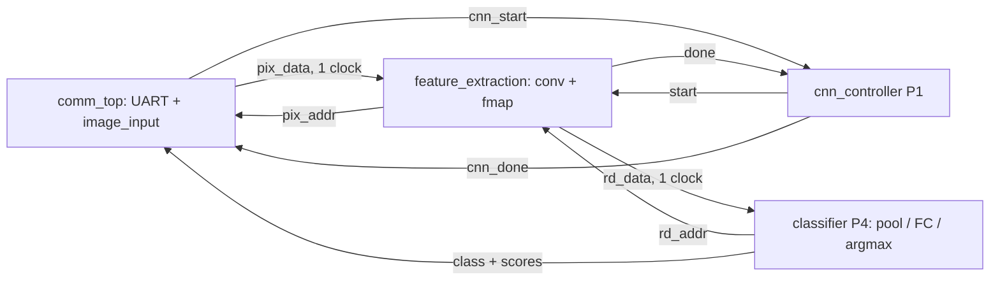

# Hardware — Basys 3

Panduan port, aritmetika dan verifikasi subsistem.
[Perintah tes dan susunan testbench](../tests/README.md).

## Modul RTL

| Kelompok | Modul | Pemilik |
|---|---|---|
| Feature extraction | rtl/feature_extraction/: conv, ROM, requant, fmap dan wrapper feature_extraction | P3 |
| Komunikasi | rtl/communication/: UART RX/TX, frame controller dan wrapper comm_top | P5 |
| Input | rtl/input/image_input.v: live RAM dan stored ROM | P5 |
| Classification | rtl/classification/: maxpool2d, FC, argmax dan wrapper classifier | P4 |
| Control | rtl/control/: cnn_controller dan cnn_core | P1 |
| Board | rtl/top/top_basys3.v, rtl/board/: tombol dan seven-segment | P1/P4 |

[Tes P3 dan sintesis](../tests/README.md#p3-feature-extraction) · [Tes P5 dan dummy top](../tests/README.md#p5-komunikasi).
Nama modul dan port lama dipertahankan. Path dikelompokkan per fungsi; semua
source produksi tercatat di rtl/files.f, dibaca runner dan rtl/read_sources.tcl.
Implementasi controller, pooling, FC, argmax, display dan top/XDC tersedia
di main. Jalur CNN lengkap LIVE telah diuji fisik pada 3 November 2026;
hasil dan batas bukti dicatat di bagian akhir panduan ini.

## P3 feature extraction

Owner: Mahardika (P3). Buddy: Kania Ika (P4). P3 owns the convolution layer, from the input-image read port to the 1,568 activations in `fmap_ram`.

The arithmetic is P2's integer contract (`reference_model/README.md`), and the weights and biases are P2's files. The current model is p2-doc-int-v2, in `reference_model/models/p2-doc-int-v2/`, with its golden model in `reference_model/document_v2/golden.py`. The older p2-int-v1 still runs, with a 32-bit accumulator.

### Files

| File | What it is |
| --- | --- |
| `rtl/feature_extraction/feature_extraction.v` | Production P3 wrapper: convolution and feature memory with a public synchronous read port |
| `rtl/feature_extraction/conv_engine.v` | 3×3 convolution, 8 filters, `N_MAC` = 1 (default), 3 or 9 multipliers, `ACC_W`-bit accumulator (24 by default); contains `conv_wrom`, `requant_relu` and, with 3 or 9 multipliers, `conv_window` |
| `rtl/feature_extraction/conv_window.v` | For 3 and 9 multipliers: reads each pixel once, in raster order, into a 3×3 register window fed by two 13-pixel line buffers, and issues the multiply steps of each window position |
| `rtl/feature_extraction/conv_wrom.v` | The 72 weights and 8 biases in LUTs, 1-cycle reads, loaded from P2's `conv_weight.mem` and `conv_bias.mem`; a read returns a weight, a kernel row or a whole kernel (`TAPS` = 1, 3 or 9) |
| `rtl/feature_extraction/requant_relu.v` | `q = min(127, (max(0, acc)*M + 2^(S-1)) >> S)` in 48 bits, 2-cycle pipeline |
| `rtl/feature_extraction/fmap_ram.v` | 1,568-byte simple dual-port block RAM: `conv_engine` writes, `maxpool` reads |
| `tests/rtl/p3/conv_engine_tb.v` | `conv_engine` + `fmap_ram`; checks all 1,568 accumulators, activations and overflow flags of each image bit-exact, and the version's cycle count |
| `tests/rtl/p3/requant_relu_tb.v` | 10,000 accumulator values per (M, S, width), checks the result, order and latency |
| `tests/rtl/p3/p3_vectors.py` | P3's own integer reference of the conv layer, and P3's test vectors |
| `tests/rtl/p3/p2_vectors.py` | Tests from P2's packages: their own golden vectors, or P2's golden model when a package has none |
| `tests/rtl/p3/run_p3_tests.py` | Runs everything, for each `N_MAC`, and prints PASS/FAIL |
| `tests/rtl/p3/synth_p3.tcl`, `tests/rtl/p3/p3_synth_top.v` | Out-of-context synthesis, place and route of the block for one `N_MAC`, for timing, resources and power |
| `tests/rtl/p3/conv_engine_tb.gtkw` | GTKWave layout for the engine's waveform: signals grouped by pipeline station |

### Running the tests

```powershell
python tests/rtl/p3/run_p3_tests.py                                   # Icarus Verilog
python tests/rtl/p3/run_p3_tests.py --sim xsim --vivado-bin C:/Xilinx/Vivado/2019.1/bin
python tests/rtl/p3/run_p3_tests.py --vectors path/to/package          # on one P2 package outside the repository
python tests/rtl/p3/run_p3_tests.py --wave                             # also save waveforms (.vcd)
python tests/rtl/p3/run_p3_tests.py --mac 1                            # only the default engine (N_MAC = 1)
gtkwave build/p3_sim/iverilog/p2-doc-int-v2/conv_engine_tb.vcd tests/rtl/p3/conv_engine_tb.gtkw
```

Vectors, logs and simulator files go to `build/p3_sim/`, which Git ignores. The P2 tests need NumPy and Pillow, as in P2's `reference_model/requirements.txt`. Missing dependencies, missing model packages and packages without input images make the run fail; an empty test selection never counts as success.

Run the runner's regression checks with standard-library unittest:

```powershell
python -m unittest discover -s tests/rtl/p3 -p test_run_p3_tests.py
```

The suite has 47 tests. `conv_engine_tb` runs on P3's 7 sets and P2's 2
packages, and `feature_extraction_tb` (the production wrapper, read back
through its port) on the 2 packages, each for `N_MAC` = 1, 3 and 9: 33 tests.
The other 14 run once: 13 `requant_relu_tb` cases, and a P5 stored-input -> P3
integration test on all 16 stored pictures with the default engine. The 3- and
9-multiplier tests run in `mac3/` and `mac9/` subfolders with a copy of the
vectors; `--mac` picks the versions. On 3 November all 47 passed on Icarus and
on Vivado 2019.1's xsim.

- `conv_engine_tb` on p2-doc-int-v2's own 25 golden vectors: 20 validation pictures and P2's 5 synthetic inputs. The engine is compiled with no parameters (`P2_DEFAULTS`), as a top that passes none, so this test also checks that its defaults are P2's current model. The 3- and 9-multiplier runs pass only `N_MAC`.
- `conv_engine_tb` on p2-int-v1, whose package has no vectors: 20 pictures (P2's example of each class, the 5 synthetic inputs and 7 random pictures) checked against v1's `golden.py`, with `ACC_W` = 32.
- `conv_engine_tb` on P3's random model (20 images), on the accumulator limits, on an overflow that must be flagged, and on overflows that a later product cancels, each at 24 and 32 bits.
- `requant_relu_tb` with 10,000 values for each of 13 cases: 11 (M, S) pairs from S = 0 to 47 at 24 bits, including P2's (43980, 25) and (34172, 25), and 2 at 32 bits.

Before the P2 tests, the runner checks P2's checksums, that the `.mem` files hold the same numbers as `parameters.npz`, and that P3's own reference gives every accumulator and activation P2 expects.

`conv_engine_tb` also compares each output's overflow flag with P3's reference: whether a partial sum of P2's serial order left the `ACC_W`-bit range. `ovf` at `done` must be set exactly for the images that have such an output, and every run ends with a reset in mid-run, after which busy, done, reads and writes must stay low. In `conv_ovf_partial`, filter f has two weights: a 255 under tap f takes partial sum f+1 past a limit by 127 (even filters at the top, odd ones at the bottom), and a 1 under the next tap brings it back, so only the flag shows the overflow, which P2's golden rejects. The 8 filters cover the 8 partial sums before the last; the second image takes each of them exactly to its limit without crossing it. `conv_ovf_flag` crosses at the last partial sum, and `conv_extremes` ends exactly on both limits.

What the tests show about p2-doc-int-v2: filter 2 can never fire. Even with 255 under each of its positive weights it reaches only −538, so its activations are always 0. The other 7 filters all fire on the real pictures; filter 3, which never fired on v1's class examples, now fires on 74% of its outputs. No activation is clipped (none of the 39,200 reaches 127), and the largest accumulator is 95,531, far inside 24 bits.

`conv_engine_tb` compares in the order P2's handoff asks for: each of the 1,568 accumulators as it finishes, then each activation read back from `fmap_ram`. The accumulators catch errors the rescale can hide: a planted bug that gave 7 outputs per picture the wrong bias changed 140 accumulators but only 67 activations. Every bug planted on purpose has been caught: 13 in the 32-bit version, then 7 more for the 24-bit version, including a 32-bit default reading v2's 6-digit biases (29,400 wrong accumulators), then 15 in the 3- and 9-multiplier versions: a missing check of a row's first or second partial sum, of rows 0 and 1, or on the wrong bit (only the overflow flags fail), a line buffer one pixel short, the next pixel read a step early, a reset that leaves the reader running, the wrong kernel row, no restart from the bias, row 2 a cycle early, and the bias read a stage early. (With 3 multipliers that last one changes nothing: a filter's first kernel row is always followed by its second.)

`--vectors DIR` runs the core/wrapper tests (and stored-input integration when available) on one P2 package folder outside the repository, such as a new export: `contract.json`, `mem/`, and `vectors/<name>/` with `input.mem`, `conv_acc.mem` and `activation.mem`, as P2's export writes them.

With `--wave`, each test also saves a waveform next to its log. `conv_engine_tb` records one picture's run and read-back (picture 3 by default, about 6 MB; set `DUMP_IMG` to pick another). In p2-doc-int-v2's vectors, picture 3 is a Yield sign. GTKWave comes with Icarus Verilog; the `.gtkw` layout opens at the start of the run and shows the default engine's signals (`dut.g_serial`). The first result is stored at the end of tick 14, and `done` rises at tick 14,117.

### Synthesis

```powershell
vivado -mode batch -nojournal -log build/p3_synth/mac1.log -source tests/rtl/p3/synth_p3.tcl
vivado -mode batch -nojournal -log build/p3_synth/mac9.log -source tests/rtl/p3/synth_p3.tcl -tclargs 9
```

Run it from the repository root in the Vivado Tcl Shell, or with Vivado's `bin` folder on PATH. `-tclargs` takes the number of multipliers (1, 3 or 9; default 1) and, in either order, another 24-bit set of weights and biases instead of p2-doc-int-v2's. Reports go to `build/p3_synth/mac<N>/`, and the log's last lines sum them up. The results below are out of context on the XC7A35T (`xc7a35tcpg236-1`) after place and route. The historical rows use Vivado 2019.1; the refactor row uses Vivado 2026.1, so resource differences are not evidence of an RTL optimization. The run assumes `pix_data` arrives 3 ns after the clock (P5's block RAM plus `input_mux`) and `pix_addr` must leave 2.5 ns before it:

| Version | Timing at 100 MHz | LUTs | Flip-flops | Block RAM | DSP48E1 | Dynamic power |
| --- | --- | --- | --- | --- | --- | --- |
| N_MAC = 1, p2-doc-int-v2 (3 November, Vivado 2019.1) | Met, 3.413 ns of slack (about 152 MHz) | 121 | 99 | 1 RAMB18 (half a tile) | 2 | about 6 mW (vectorless) |
| N_MAC = 3, p2-doc-int-v2 (3 November, Vivado 2019.1) | Met, 2.383 ns of slack (about 131 MHz) | 239 | 180 | 1 RAMB18 | 4 | about 11 mW (vectorless) |
| N_MAC = 9, p2-doc-int-v2 (3 November, Vivado 2019.1) | Met, 2.725 ns of slack (about 137 MHz) | 261 | 180 | 1 RAMB18 | 10 | about 19 mW (vectorless) |
| Refactor, p2-doc-int-v2 (3 November, Vivado 2026.1) | Met, 3.715 ns of slack | 102 | 99 | 1 RAMB18 (half a tile) | 2 | vectorless estimate only |
| p2-doc-int-v2, 24-bit (2 November) | Met, 3.62 ns of slack (top speed about 157 MHz) | 123 | 99 | 1 RAMB18 (half a tile) | 2 | about 6 mW (estimate) |
| p2-int-v1, 32-bit (2 November) | Met, 1.12 ns of slack (about 113 MHz) | 263 | 132 | 1 RAMB18 | 1 | about 8 mW |
| P3's random model, 24-bit (30 October) | Met, 3.53 ns of slack (about 155 MHz) | 116 | 88 | 1 RAMB18 | 2 | about 5 mW |

N_MAC = 1 is the unchanged engine. The same Vivado 2019.1 run on `main` before the multiplier versions (fcf3e96) gives 123 LUTs, 99 flip-flops, 2 DSP48E1 and 3.619 ns of slack. The engine's own logic has the same size in both (82 LUTs, 64 flip-flops, 1 DSP); the 2 LUTs and 0.2 ns are in `requant_relu`, which did not change, and in placement.

| `N_MAC` | Cycles per image | Time at 100 MHz | DSP48E1 | Dynamic energy per image (Vivado 2019.1, vectorless) |
| --- | --- | --- | --- | --- |
| 1 | 14,117 | 141.2 µs | 2 | about 0.85 µJ |
| 3 | 4,770 | 47.7 µs | 4 | about 0.52 µJ |
| 9 | 1,636 | 16.4 µs | 10 | about 0.31 µJ |

The energy is the vectorless dynamic power times the run time: estimates with Vivado's default switching activity, not measurements. The chip's static power, about 68 mW, is the same for all three. The top speeds are 1/(10 ns − slack), estimates from runs constrained at 100 MHz. With 3 multipliers, Vivado puts each multiply in a DSP slice and the accumulator's three adders in the fabric (`use_dsp = "no"`): chained through the three DSP slices instead, they left only 0.87 ns of slack, because the accumulator feeds the next row through them. With 9 multipliers, each kernel row is a cascade of three DSP slices, multiplying and adding: the rows form a pipeline, not a loop, so the cascade is fast enough, and the pixel and weight delays of rows 1 and 2 go into the DSP slices' input registers. The slowest path there is the weight ROM's routing to the DSP columns.

Both multiplies of N_MAC = 1 are in DSP slices. One holds the conv multiply-accumulate. With a 24-bit accumulator, the rescale multiplies 23 bits by M's 16 bits, which fits one DSP48E1 (25 × 18 bits), and Vivado puts it there by itself: `requant_relu` takes 36 LUTs and 1 DSP. With v1's 32-bit accumulator the multiply was 31 × 16 bits, wider than one slice, and Vivado built it from LUTs instead, as shifts and adds: 165 LUTs, and the slowest path (8.9 ns from `acc` to `prod`).

In the historical 2 November Vivado 2019.1 result, the slowest path was `pix_addr` leaving the block: 2.87 ns through one LUT after the `kr` counter, with 2.5 ns assumed for `input_mux` outside. Inside the block, the slowest is `acc` into the rescale's DSP, with 3.64 ns of slack. The conv multiply carries `(* use_dsp = "yes" *)`: without it, Vivado builds that small multiply from LUTs, and it becomes the slowest path from `pix_data`.

### `conv_engine` ports

Parameters, with defaults from p2-doc-int-v2's `params.vh`: `M` = 43980 and `S` = 25 (rescale), `ACC_W` = 24 (the accumulator, and the width of each `conv_bias.mem` word), `WEIGHT_FILE` = `"conv_weight.mem"`, `BIAS_FILE` = `"conv_bias.mem"`. `N_MAC` = 1 picks the number of multipliers, 1, 3 or 9 ([Multiplier versions](#multiplier-versions-n_mac)); it is not part of P2's model, and `feature_extraction` passes it through.

For integration, instantiate `feature_extraction` (or `conv_engine` when providing your own feature memory) with no parameters, or include P2's `params.vh` and pass `.M(P2_RESCALE_M), .S(P2_RESCALE_S), .ACC_W(P2_ACC_BITS)`, so that a new model version needs no RTL edit. The corrected P2 header in `main` has no global include guard: include it once inside each consuming module, or include it in `cnn_core` and pass the constants down. Add P2's `mem/conv_weight.mem` and `mem/conv_bias.mem` to the Vivado project (`read_mem` in a non-project Tcl flow) so `$readmemh` finds them. For p2-int-v1, pass `M` = 34172 and `ACC_W` = 32.

| Port | Dir | Width | Meaning |
| --- | --- | --- | --- |
| `clk` | in | 1 | 100 MHz |
| `rst` | in | 1 | Synchronous, active high, from `top`'s reset synchroniser |
| `start` | in | 1 | One-cycle pulse; ignored while `busy` |
| `busy` | out | 1 | High from the cycle after `start` until `done` |
| `done` | out | 1 | One-cycle pulse; all 1,568 values are in `fmap_ram` |
| `ovf` | out | 1 | A partial sum of P2's serial order (the bias, plus the products one at a time) left the `ACC_W`-bit range during this run, even if a later product brought it back; the same in every version. The contract forbids it; for p2-doc-int-v2 it cannot happen |
| `pix_rd` | out | 1 | `pix_addr` is a real read this cycle |
| `pix_addr` | out | 8 | `row*16 + col` of the input image |
| `pix_data` | in | 8 | Unsigned pixel, exactly 1 cycle after `pix_addr` |
| `fm_we`, `fm_addr`, `fm_data` | out | 1, 11, 8 | Write port into `fmap_ram`: `filter*196 + row*14 + col`, value 0..127 |

Timing, measured in simulation: **14,117 cycles from `start` to `done`** (141 µs at 100 MHz): 1,568 outputs × 9 taps, plus 5 cycles of pipeline. Every image takes the same number of cycles. With 3 multipliers a run takes 4,770 cycles (47.7 µs), with 9 it takes 1,636 (16.4 µs).

### Multiplier versions (`N_MAC`)

`N_MAC` picks how many multipliers work in parallel. All three versions add the same products in the same order, so they give the same accumulators, activations and `ovf`, bit for bit, with the same ports, handshake and `fmap_ram` layout. Only the cycle count and the resources differ. The default is 1, and `cnn_core` and the board use it.

| `N_MAC` | Each clock | Image reads per run | Cycles per image |
| --- | --- | --- | --- |
| 1 | one product | 14,112, one per product | 14,117: 14,112 steps and 5 of pipeline |
| 3 | a kernel row: 3 products | 256, each pixel once | 4,770: 4,704 steps, 61 while the window fills, 5 of pipeline |
| 9 | a whole kernel: one output | 256 | 1,636: 1,568 steps, 61 while the window fills, 7 of pipeline |

**Window.** The image has one read port with a one-clock read: enough for one pixel per clock, but 3 or 9 multipliers need 3 or 9. So the 3- and 9-multiplier versions read each pixel once, in raster order, through `conv_window`, which keeps the newest 3×3 neighbourhood in registers. Two line buffers of 13 pixels hold the rest of the two rows above; they are shift registers without reset, which Vivado builds from SRL LUTs. Pixel (y, x) with y ≥ 2 and x ≥ 2 completes the window of output (y−2, x−2).

**Loop order: output row, output column, filter, then kernel row (`N_MAC` = 3).** Each window position stays in the registers while all 8 filters use it, so the image is read once per run and the read port is idle most of the time. The serial engine's filter-first order would have to slide the window over the image, and fill it, 8 times. The next pixel is read in the cycle of a window's last step, so consecutive windows follow without a gap. The 61 cycles without a multiply are the window filling: its first 35 pixels, then 2 at the start of each new row.

**Sums.** P2's contract adds the bias, then the 9 products in kernel order, and P2's golden rejects an overflow of any partial sum, even one that a later product cancels. So each product enters the sum through an adder of its own, in kernel order, and every partial sum of the contract exists in hardware and is checked:

- `N_MAC` = 3: each clock adds a kernel row's 3 products to the accumulator, which starts at the bias: three chained adders, three checks.
- `N_MAC` = 9: three pipelined stages, one per kernel row, each with the same three adders. Rows 1 and 2 hold their pixels and weights for one and two more cycles before their multipliers, so each row's products meet the sum of the rows above.

Within a row, a partial sum is exact in `ACC_W` + 1 bits, and it is out of range when its top two bits differ, the serial engine's test. Between rows the sum keeps `ACC_W` bits, as the serial accumulator does. So `ovf` means the same in every version. An adder tree would be shorter, but its partial sums are not the contract's, so it could not check them.

**Weights.** `conv_wrom` is a LUT ROM. With `TAPS` = 3 or 9, a read returns a kernel row (address filter×3 + kernel row) or a whole kernel (address filter).

**Board default.** A faster version changes `cnn_core`'s latency (23,542 cycles per image, locked by `cnn_core_tb`), so making one the board default is P1's integration task.

### `fmap_ram` ports (for P4's `maxpool`)

| Port | Dir | Width | Meaning |
| --- | --- | --- | --- |
| `we`, `waddr`, `wdata` | in | 1, 11, 8 | From `conv_engine` |
| `raddr` | in | 11 | `filter*196 + row*14 + col` |
| `rdata` | out | 8 | 0..127, exactly 1 cycle after `raddr` (no output register) |

`maxpool` may start reading in the cycle after `conv_engine`'s `done`. With 3 or 9 multipliers, `conv_engine` writes each window position's 8 filters in turn, 196 addresses apart, instead of counting up; every address is still written exactly once before `done`.

### How the RTL follows P2's contract

| Contract | P3's RTL |
| --- | --- |
| Pixels uint8, zero-extended before the multiply | `$signed({1'b0, pix_data}) * w_data`, a 17-bit product |
| Weights int8, OIHW, address `f*9 + ky*3 + kx` | `conv_wrom`, loaded from `conv_weight.mem` as delivered |
| Biases have the accumulator's type, int24 in v2 (int32 in v1); the accumulator starts at the bias and adds the products in kernel order | `ACC_W`-bit `acc` and bias words, 24 by default, starting at the filter's word of `conv_bias.mem`; every `N_MAC` adds the products in kernel order, each with an adder of its own |
| Accumulator overflow is forbidden, at every partial sum, even if a later product cancels it | `ovf` goes high if any partial sum leaves the `ACC_W`-bit range, in every version. p2-doc-int-v2's bound is 167,442, far inside 24 bits |
| `P = max(0, A)`, then `min(127, (P*M + R) >> S)`, with `R = 2^(S-1)`, or 0 when S = 0, computed in 48 bits (v1 said 64) | `requant_relu`: the ReLU, a 23 × 16-bit multiply (`ACC_W` − 1 bits by 16), then a 48-bit round and shift. 48 bits hold every legal value even with a 32-bit accumulator, so the result also equals v1's 64-bit formula |
| Activations 0..127, address `(f*14 + y)*14 + x` | `fmap_ram`, address `filter*196 + row*14 + col` |

### What P3 needs from each person

| From | What |
| --- | --- |
| P1 Saufik | Instantiate `conv_engine` with no parameters, or with `P2_RESCALE_M`, `P2_RESCALE_S` and `P2_ACC_BITS` from P2's `params.vh`, included once; add P2's `conv_weight.mem` and `conv_bias.mem` to the Vivado project; review this code |
| P2 Rubi | A look at filter 2, which can never fire in v1 or v2; agreement that P3 follows the v2 contract |
| P4 Kania | Read `fmap_ram` with a 1-cycle read; start `maxpool` after `done`; review each other's code as buddies |
| P5 Dika | Already met: `image_input` gives the pixel 1 cycle after the address. The image must not change during a 141 µs run. v2's 16 stored pictures are P2's `signs.mem` |

### What P3 delivers

| When | Deliverable |
| --- | --- |
| Day 2 | `conv_engine` and `requant_relu` passing against P2's dumps, plus the overflow test; present at 14:00 |
| Day 3 | Help `cnn_core` integration; add 3- and 9-multiplier versions behind a parameter |
| Day 4 | Fix integration bugs; finish the multiplier versions; check the rescale path for timing |
| Day 5 | Multiplier sweep: cycles, DSPs, LUTs, BRAM, top clock speed, power and energy per image |
| Day 6 | Debug support; check the on-board latency (B5) |
| Day 7 | Slides on architecture, convolution and trade-offs |

3 November: the 3- and 9-multiplier versions are in, behind `N_MAC` ([Multiplier versions](#multiplier-versions-n_mac)), with each version's cycles, resources and estimated power and energy from Vivado 2019.1 above. The board still runs `N_MAC` = 1.

## P5 komunikasi

### Kontrak UART final Basys 3

Transport produksi menggunakan **115200 baud, 8N1**, request 259 byte dan
reply 32 byte. Pilihan ini mengikuti implementasi RTL dan client yang lulus
uji fisik. Memotong satu byte hanya menghemat sekitar 87 µs pada baud ini.

| Arah | Layout byte, dari awal frame |
|---|---|
| Laptop → FPGA | `A5 \| CMD (01) \| 256 piksel uint8 row-major 16×16 \| CHK` |
| FPGA → laptop | `5A \| STATUS \| CLASS \| CYCLES (4 byte) \| SCORE[0..7] (3 byte per skor) \| CHK` |

`CHK` adalah jumlah byte di antara sync dan checksum modulo 256.
`CYCLES` adalah unsigned32 big-endian pada clock 100 MHz. Skor adalah signed24
two's complement big-endian, berurutan sesuai indeks kelas paket v2.
Status yang dikirim FPGA adalah `00` (hasil tersedia), `01` (checksum salah),
dan `03` (command tidak dikenal). Untuk reply error, kelas, siklus dan skor
bernilai nol. Frame terputus dibuang setelah timeout antar-byte 10 ms tanpa
reply. Label legacy `02` pada client tidak dikirim RTL produksi. Client
menunggu maksimal 200 ms per percobaan dan mengirim ulang sekali jika reply
belum lengkap. Host mengirim satu request dan menunggu reply sebelum request
berikutnya. Tombol stored menampilkan hasil secara lokal. Overflow dilaporkan
melalui LED13 dan tidak memiliki status UART tersendiri.

Metadata 31 byte/cycles24 di paket P2 tersegel merupakan target historis.
Bagian ini adalah acuan transport produksi. Perubahan format berikutnya
memerlukan pembaruan kedua endpoint dan pengujian integrasi bersama.

Jalankan dari root repo dengan Python dan Icarus Verilog pada PATH:

```powershell
python tests/rtl/p5/run_p5_tests.py
```

Runner menjalankan tes UART dan komunikasi lengkap dengan dummy CNN pada
16 clocks/bit serta 868 clocks/bit (100 MHz / 115200 baud), kemudian selftest
`apps/board_hmi/tsr_link.py`. Log dan hasil kompilasi disimpan di `build/p5_sim/`.
Runner memberi exit code nonzero jika kompilasi/simulasi gagal, timeout,
atau penanda kelulusan tidak ditemukan.

Cakupan tes:

- UART: byte berurutan tanpa jeda tambahan, stop bit LOW, break panjang,
  glitch saat break, pemulihan setelah idle, glitch start pendek, dan
  pulsa valid sepanjang satu clock.
- Komunikasi: gambar live, checksum salah, command tidak dikenal,
  timeout dan pemulihan, 16 gambar tersimpan, serta checksum dengan stop
  bit invalid. Frame terakhir harus tidak memulai CNN atau mengirim balasan;
  setelah timeout, frame valid berikutnya harus berhasil.
- Kegagalan pemeriksaan (termasuk nilai X/Z) dan watchdog testbench memakai
  `$fatal(1, ...)`. Runner juga memeriksa penanda lulus dan pesan kegagalan,
  karena beberapa versi lama `vvp` Windows tetap memberi exit code 0 setelah
  `$fatal`. Gunakan runner ini untuk pemeriksaan otomatis.

UART membuang byte dengan stop bit LOW dan menunggu satu bit penuh HIGH
sebelum menerima start berikutnya. Tidak ada balasan khusus framing-error;
frame yang kekurangan byte dibuang oleh timeout `frame_ctrl`, lalu laptop
mengulang permintaan sesuai mekanisme yang sudah ada.

Waveform komunikasi bersifat opsional: tambahkan `-DDUMP` saat mengompilasi
`tb_comm` untuk menghasilkan `tb_comm.vcd` pada direktori kerja simulator.
Tes ini belum menggantikan pengujian board fisik atau integrasi CNN nyata.

## Integrasi antarsubsistem

```text
rtl/
  files.f                   # satu daftar source produksi
  read_sources.tcl          # pembaca source untuk Vivado
  feature_extraction/       # P3 + wrapper feature_extraction
  communication/            # P5 UART/frame + wrapper comm_top
  input/                    # live RAM / stored ROM
  classification/           # maxpool, FC, argmax dan wrapper P4
  control/                  # sequencer P1 dan CNN core
  board/                    # button debounce dan display
  top/                      # top_basys3
```

Gunakan **feature_extraction** sebagai boundary P3 dan **comm_top** sebagai
boundary P5. Wrapper P3 merangkum conv_engine dan fmap_ram tanpa register
tambahan. comm_top dipromosikan dari test support menjadi source produksi;
dummy_cnn dan top bring-up tetap di tests/rtl/p5/.



| Boundary | Aturan integrasi |
|---|---|
| Pixel P5 -> P3 | pix_addr ke img_raddr, img_rdata ke pix_data. image_input sudah satu clock; jangan tambahkan register data lagi |
| Start | cnn_start masuk controller; controller memberi satu pulsa start P3 ketika idle |
| Feature memory | P4 memakai rd_addr/rd_data setelah P3 done; alamat CHW filter*196+row*14+col |
| Selesai CNN | P5 cnn_done berarti seluruh klasifikasi selesai, bukan hanya done convolution |
| Output classifier | class 3 bit; skor signed24 pada cnn_scores[24*k +: 24]; cycles P5 masih 32 bit |
| Input ownership | live_mode, stored_sel dan gambar harus stabil selama proses; controller mengatur arbitrasi stored/live |
| Parameter | Pass M, S, ACC_W, WEIGHT_FILE dan BIAS_FILE dari paket P2 yang sama; wrapper default p2-doc-int-v2. N_MAC (default 1) memilih jumlah multiplier P3 dan mengubah latensi convolution |
| Clock/reset | P3 rst synchronous active-high. P5 mempertahankan power-up initialization tanpa reset port; reset bersama perlu perubahan integrasi terpisah |
| UART | 115200 8N1, request 259 byte, reply 32 byte/cycles32 sesuai [kontrak final](#kontrak-uart-final-basys-3) |

Vivado: `source rtl/read_sources.tcl`, lalu baca top/XDC yang sesuai. Tambahkan
file .mem dari paket model ke project/working directory. Manifest hanya memuat
source produksi, tanpa dummy/testbench. Top board awal: top_basys3; prosedur build ada di bawah.

### Verifikasi refactor 3 November 2026

- Port, pipeline, power-up state dan lebar numerik lama dipertahankan.
- Konstanta dimensi/protokol diberi nama; FSM memakai konstanta selebar state.
  P5 memakai timescale dan default_nettype eksplisit.
- Perbandingan P5 dengan source baseline `d4b51df7`: 287.982 siklus pada skenario
  normal/error/recovery/stored; tx, start, pixel dan error identik.
- Golden core, wrapper readback dan P5 stored-input -> P3 memverifikasi boundary
  yang tersedia. Ini belum membentuk CNN classifier lengkap.
- Icarus: 23/23 tes P3, enam regresi runner dan seluruh tes P5 pada 16/868 clocks per bit lulus. Latensi P3 tetap 14.117 siklus per gambar.
- Vivado 2026.1: wrapper P3 lolos sintesis/place/route pada target 100 MHz, WNS +3,715 ns. Hasil ini out-of-context; board fisik belum diuji ulang setelah refactor.

## Profil RTL D42

Build `d42` memakai paket eksperimen `p2-doc-d42-int24-v1`. Parameter
`ENABLE_CONV2` memilih jalur classifier dengan Conv kedua di antara pool dan
FC. Default 0 memilih baseline A. Pada D42, pool 8×7×7 dibaca satu clock
oleh Conv 8→8, kernel 3×3, stride 1 dan zero-padding 1. Hasil requantization
ditulis ke RAM aktivasi terpisah dan dibaca satu clock oleh FC. Akumulator
bias-first mengikuti urutan CHW dan memeriksa setiap partial sum signed24.
Overflow Conv kedua digabung dengan overflow FC pada keluaran classifier.

```powershell
vivado -mode batch -source scripts/build_basys3.tcl -tclargs d42
```

Build membaca konstanta kedua Conv dari `params.vh` D42 dan menyalin enam
memori parameter beserta bank stored ke `build/basys3_d42/`. Antarmuka
eksternal D42 memakai 16×16, delapan kelas, request UART 259 byte dan reply
32 byte dengan siklus unsigned32. Latensi D42 dilaporkan oleh counter CNN.
Gunakan golden dan bank stored dari paket D42 saat memeriksa bitstream D42.

Pada Vivado 2026.1 untuk xc7a35tcpg236-1, build D42 selesai routing dan
bitgen dengan setup slack +0,845 ns, hold slack +0,060 ns, dan tanpa DRC error.
Resource D42: 1.331 LUT, 1.004 FF, 3 BRAM tile, 5 DSP. Baseline A pada build
terdokumentasi sebelumnya memakai 1.104 LUT, 932 FF, 2,5 BRAM tile, 3 DSP.
Simulasi mengukur D42 81.168 siklus (811,68 µs pada 100 MHz) dan A 23.542
siklus (235,42 µs). Bitstream D42 SHA256
`b0ea6d7b5d309f8ac9d6775f57414b7a794dff1b974b5eb47c60db4ef02d2481`.
Bitstream dari source `c6902cae` diprogram melalui JTAG dan diuji fisik
pada 3 November 2026. Dari 255 balasan UART, 250 merupakan inferensi
25 golden × 10 putaran, tiga inferensi pemulihan, dan dua reply error
yang diharapkan. Seluruh 2.024 skor signed24 dan kelas inferensi valid
cocok dengan golden. Latensi fisik 81.168 siklus (811,68 µs), median
round-trip 31,92 ms. Checksum salah dan command tidak dikenal mendapat
status 1 dan 3, frame terputus tidak mendapat balasan, dan setiap
permintaan valid berikutnya pulih. Tidak ada retry.

Profil `p2-doc-d42-int24-v1` terdaftar di Model Studio dengan hash paket
dan bitstream yang diuji. Raw capture lokal ada di
`build/board_validation/results_d42_live.json`. Uji ini mencakup LIVE.
Jalur tombol stored D42 lulus simulasi dan memerlukan observasi manual
tersendiri pada board.

### Resource modul fully connected

Laporan hierarkis Vivado 2026.1 dari build PR #7 mencatat pemakaian
instans `u_fc` berikut. Persentase dihitung dari kapasitas XC7A35T.

| Resource | Kapasitas | FC baseline A | FC D42 |
|---|---:|---:|---:|
| LUT | 20.800 | 541 (2,60%) | 559 (2,69%) |
| Flip-flop | 41.600 | 246 (0,59%) | 247 (0,59%) |
| BRAM tile | 50 | 0 (0%) | 0 (0%) |
| DSP | 90 | 1 (1,11%) | 1 (1,11%) |

Kedua profil memakai `fc_engine` dengan 392 fitur, delapan skor, dan satu
jalur MAC serial. Laporan Vivado mencatat nol BRAM untuk FC. Pada build
yang sama, total top memakai 1.106 LUT untuk A dan 1.331 LUT untuk D42,
sehingga FC menyumbang sekitar 49% dan 42% dari LUT desain masing-masing.

## Datapath eksperimen C-43

Simulasi C-43 seed 44 memakai modul Conv, RAM fitur, maxpool, FC, dan
argmax dengan parameter 16 filter dan 43 kelas. Pool menghasilkan 784
fitur CHW untuk FC. Jalur skor berukuran 43×24 bit dan indeks kelas 6 bit.
Default modul untuk profil A dan D42 tetap delapan kelas.

Testbench mencocokkan seluruh layer dan 1.978 skor pada 46 vektor.
Datapath dari start Conv hingga done argmax membutuhkan 101.970 siklus
(1,0197 ms jika clock 100 MHz). Angka ini berasal dari simulasi datapath.
[Perintah simulasi](../tests/README.md#datapath-c-43-seed-44).

Top eksperimen `top_basys3_c43` memakai clock core 50 MHz dari clock board
100 MHz, ROM bobot FC di block RAM, dan bank
16 citra stored dari hasil evaluator seed 44. Siapkan bank dan jalankan build
dengan perintah berikut.

```powershell
python scripts/package_c43_board.py build/c43_official build/model_studio/packages/p2-doc-c43-s44-int24-v1
vivado -mode batch -source scripts/build_basys3.tcl -tclargs c43
```

Build Vivado 2026.1 dari RTL `bf682e5a` lulus timing pada 50 MHz
dengan setup slack +4,658 ns, hold slack +0,069 ns, dan nol error DRC.
Hasil pasca-routing memakai 1.720 LUT (8,27%), 1.362 FF (3,27%),
19 BRAM tile (38,00%), dan 4 DSP (4,44%). Percobaan 100 MHz dengan
ROM BRAM menghasilkan setup slack −2,109 ns pada jalur bobot FC ke skor.
Simulasi top 50 MHz lulus untuk semua 16 slot stored.

Model Studio mendaftarkan arsip bitstream dengan SHA256
`c8c5e5fc678b8806be81e4ca916c9619321808e3aa9f5b52a49316bfe0a8f67a`.
Arsip berada di `build/model_studio/experimental/p2-doc-c43-s44-int24-v1/`
dan dipisahkan dari output build Vivado.

Paket lokal memuat `stored_manifest.json` dengan prediksi golden untuk tiap
slot. Atur SW15=0 dan SW3–SW0 ke slot yang diinginkan, lalu tekan BTNC.
Dua digit kanan menampilkan ID GTSRB desimal 00–42, LED5–LED0 menampilkan
ID biner, LED15 menandai busy, LED14 menandai hasil tersedia, dan LED13
menandai overflow. Pengguna mengonfirmasi 16/16 slot stored lulus pada
board fisik. Jalur UART C-43 idle. Latensi fisik belum diukur.

## Top Basys 3 dan implementasi awal P1/P4

`rtl/top/top_basys3.v` menghubungkan P5 ke `cnn_core`, yang merangkai P3 dan
`classifier` P4. Semua modul memakai clock board 100 MHz yang sama. Tidak ada
placeholder hasil klasifikasi pada jalur top ini; `dummy_cnn` tetap hanya untuk
tes komunikasi P5. Implementasi P4 saat ini sederhana dan serial, untuk menjadi
baseline yang mudah ditinjau sebelum optimasi resource/latensi.

| Modul | Kontrak yang dipertahankan saat dikembangkan |
|---|---|
| cnn_core | start ketika idle; busy, done satu pulsa, cycles32, ovf; pixel read satu clock; scores192/class3 |
| cnn_controller | convolution selesai -> mulai classifier -> done setelah seluruh classifier selesai |
| maxpool2d | baca fmap 8x14x14 satu clock; max unsigned 2x2 -> 392 fitur CHW |
| fc_engine | 392 fitur x 8 kelas; bobot int8, bias/partial sum signed24; cek overflow setiap penjumlahan |
| argmax | perbandingan signed24; tie memilih indeks kelas terkecil |
| classifier | boundary P4: satu read port fmap, handshake dan scores/class; pool RAM internal |
| button_pulse | sinkronisasi dua register, debounce 20 ms dan satu pulsa per tekan stabil |
| sevenseg_status | multiplex empat digit active-low, clock enable; F ditampilkan sebagai dash |

Urutan FC adalah bias terlebih dahulu, lalu fitur `channel*49+row*7+col`.
File model harus satu paket: conv_weight, conv_bias, fc_weight dan fc_bias.
Top default memakai **p2-doc-int-v2 16×16/int24**. Profil build D42 memakai
opsi Conv kedua yang dijelaskan di atas. Parameter M/S dan nama file
diteruskan oleh top/core. Dimensi eksternal tetap 16×16 dan delapan kelas.

### Kontrol dan status board

| I/O | Fungsi |
|---|---|
| clk | W5, 100 MHz / periode 10 ns |
| RsRx / RsTx | B18 / A18, USB-UART 115200 8N1 |
| btnC | U18, mulai gambar stored jika SW15=0; tekanan selama busy diabaikan |
| sw[3:0] | pilih satu dari 16 gambar stored; dilatch saat permintaan diterima |
| sw[15] | 0 mengizinkan tombol stored, 1 menonaktifkan tombol; request UART selalu memproses gambar live |
| sw[14:4] | dicadangkan, tidak memengaruhi inferensi |
| led[2:0] | indeks kelas 0..7, bermakna jika result_valid menyala |
| led[3], led[14] | result_valid, ditahan sampai proses berikutnya |
| led[4] | sumber proses terakhir/aktif: 1 UART live, 0 stored |
| led[5] | ada request UART menunggu proses stored selesai |
| led[11:6] | dicadangkan, LOW |
| led[12] / led[13] / led[15] | UART error / overflow numerik / busy |
| seg[6:0], an[3:0], dp | class pada digit kanan, dash sebelum hasil/saat busy, EEEE jika overflow; DP mati |

Mode dan stored_sel dilatch sebelum CNN mulai, sehingga perubahan switch tidak
mengubah input di tengah proses. UART mendapat prioritas jika tombol bersamaan.
Satu upload UART yang selesai saat stored sedang berjalan diantrekan dan
memakai live RAM setelah stored selesai. P5 menunggu hasil sebelum menerima
request berikutnya; tidak ada antrean multi-frame atau flow control baru.
Hasil stored ditampilkan lokal tanpa balasan UART. Hasil live membalas frame
P5 yang sama: 32 byte, cycles32 dan delapan skor signed24 big-endian.

Reset startup empat clock menginisialisasi controller/P3/P4; P5 tetap memakai
power-up initialization lama. BTNC bukan reset. Reset saat transaksi UART
berjalan belum disediakan; konfigurasi ulang FPGA menginisialisasi seluruh
subsistem bersama. Overflow dilatch pada LED13; skor overflow tidak valid dan
format status UART lama belum memiliki status overflow tersendiri.

### Constraints dan build

`constraints/basys3.xdc` memakai pin dari Basys-3-Master.xdc yang diberikan
pengguna, dengan nama port top yang sesuai. Hanya clock, UART, switch, BTNC,
LED dan seven-segment yang diaktifkan. Setting SPI flash dari master tidak
diperlukan untuk build/program melalui JTAG dan tidak disalin.

Input asynchronous melewati synchronizer; XDC mengecualikan timing eksternal
input tersebut dan output UI/UART yang tidak memiliki clock capture sinkron.
Timing antaregister tetap diperiksa pada 100 MHz. XDC tidak mematikan pemeriksaan
pin/IOSTANDARD atau DRC bitstream.

```powershell
vivado -mode batch -source scripts/build_basys3.tcl
python tests/run_rtl_tests.py --suite integration
```

Build menyalin empat memori parameter dan signs.mem dari paket v2, membaca
rtl/files.f serta XDC, kemudian synthesis/place/route, memeriksa pin dan timing,
dan membuat `build/basys3/top_basys3.bit`. Laporan timing, utilization, DRC dan
checkpoint juga disimpan di build/basys3/. Script tidak menghubungkan atau
memprogram board. Untuk GUI, gunakan source/constraint yang sama dan tambahkan
kelima file .mem ke project; pilih top_basys3 dan part xc7a35tcpg236-1.

### Bukti simulasi top awal

- 25 golden inputs: seluruh 392 hasil pool, delapan skor signed24 dan prediksi
  sama dengan P2. Latensi controller 23.542 siklus (235,42 us pada 100 MHz),
  termasuk handoff antarstage, di luar waktu upload/balasan UART.
- Reset di tengah convolution pulih; start saat busy diabaikan dan done satu pulsa.
- Argmax negatif/tie dan overflow partial sum FC yang kemudian dibatalkan produk
  berikutnya diuji secara terarah.
- Top board: 16 gambar stored cocok dengan skor/prediksi golden; pergantian
  switch dan tekanan tombol saat busy tidak mengubah input atau mengulang run.
- Satu stored run bersamaan dengan upload UART: request live diantrekan, lalu
  balasan 32 byte berisi kelas, cycles, delapan skor dan checksum yang benar.
- Ini bukti simulasi, belum pengujian CNN lengkap pada board fisik. Akurasi
  pengenalan tetap milik model P2; kesamaan golden tidak menambah akurasi model.

### Hasil implementasi Vivado 2026.1, 3 November 2026

Top penuh top_basys3 pada xc7a35tcpg236-1 selesai place/route pada 100 MHz:
WNS +0,931 ns, hold slack +0,056 ns, tanpa endpoint internal yang tidak memiliki
constraint. Resource: 1.104 total LUT (termasuk delapan SRL), 932 FF, satu RAMB36,
tiga RAMB18 dan tiga DSP. Seluruh 48 port mendapat pin unik dari master XDC dan
IOSTANDARD LVCMOS33. DRC tidak memiliki error; sembilan saran pipeline DSP
masih ada sebagai peluang optimasi daya/performa. Constraint/DRC tidak diturunkan
severity-nya. Hasil simulasi P3 (23), regresi runner (6), komunikasi P5 dan tiga
tes integrasi semuanya lulus. Build sendiri tidak membuktikan board fisik.

### Uji fisik full CNN LIVE, 3 November 2026

Basys 3 xc7a35t diprogram melalui JTAG memakai bitstream produksi `top_basys3`
dari source `3a3074cc` (berbasis main `4b3d8302`), Vivado 2026.1, model
`p2-doc-int-v2`, clock 100 MHz. Build memiliki setup +0,931 ns dan hold
+0,056 ns. SHA256 bitstream:
`aea042a52ca4a7473aea14e92caf3c185c7347862d8b1f67bac88efaa9faa662`.
Tidak ada debug wrapper/dummy atau perubahan RTL pada pengujian ini.

`apps/board_hmi/verify_board.py` memeriksa checksum paket sebelum memakai
golden terpublikasi. UART 115200 8N1 memakai request 259 byte dan reply 32 byte.
Setiap balasan diperiksa checksum, status, delapan skor signed24, kelas dan
cycle counter. Tidak ada retry otomatis yang menyembunyikan frame hilang.

| Skenario fisik | Hasil |
|---|---|
| 25 input golden × 10 putaran | 250/250 sama dengan delapan skor/prediksi golden |
| 16 gambar bank stored diunggah melalui LIVE | 16/16 sama dengan scalar golden |
| 32 input acak, seed 20261103 | 32/32 sama dengan scalar golden |
| 3 gambar RGB sintetis melalui crop/equalize/bilinear CLI | 3/3 sama dengan scalar golden |
| Bad checksum / command tidak dikenal | Status 1 / 3, nol skor dan cycles |
| Frame terputus setelah 20 byte | Tidak ada reply setelah timeout, request valid berikutnya pulih |
| Request valid setelah masing-masing tiga error | 3/3 skor/prediksi benar |

Total 306 reply: 304 inferensi valid dan dua reply error yang diharapkan;
2.432 skor sesuai golden, tanpa mismatch atau reply hilang. Semua inferensi
mengembalikan **23.542 siklus = 235,42 us**. Round-trip laptop termasuk
USB/UART/penjadwalan OS: minimum 28,46 ms, median 31,92 ms, maksimum 43,72 ms;
angka ini bukan waktu CNN saja. Sebanyak 250 run golden mengulang 25 input,
bukan 250 sampel independen, dan kesamaan golden bukan akurasi official test.

Log JTAG, raw request/reply hex, metadata/hash dan hasil setiap transaksi
disimpan lokal di `build/board_validation/` pada worktree pengujian.
Runner dapat diulang dengan port/bitstream yang diberikan eksplisit:

```powershell
python apps/board_hmi/verify_board.py <port> --rounds 10 --random 32 --bitstream <top_basys3.bit>
```

Ini membuktikan jalur fisik UART → live RAM → conv/fmap → pool/FC/argmax → UART
pada output skor, bukan readback tensor internal satu per satu. Reply UART belum
memiliki flag overflow, sehingga keadaan LED13 tidak disimpulkan dari status OK.

### Uji stored manual, 3 November 2026

Setelah pemrograman bitstream yang sama, pengguna mengonfirmasi uji fisik
SW15=0, memilih seluruh 16 indeks memakai SW3..SW0 dan menekan BTNC untuk
setiap pilihan. Digit hasil cocok dengan urutan prediksi golden:
`0,0,1,1,2,2,3,3,4,4,5,5,6,6,7,7`. Pengguna melaporkan **16/16 cocok dan
LED13 tetap mati**. Ini observasi manual pengguna atas ROM selection, pemicu
BTNC dan tampilan kelas, terpisah dari capture skor UART otomatis.

Pengujian ini tidak membaca delapan skor stored atau tensor internal secara
fisik, tidak mengukur latency stored, dan tidak mengukur margin debounce.
Pergantian switch/start saat busy serta antrean stored/live bersamaan masih
memerlukan pengujian fisik khusus; bukti yang tersedia untuk skenario itu
tetap simulasi integrasi.
