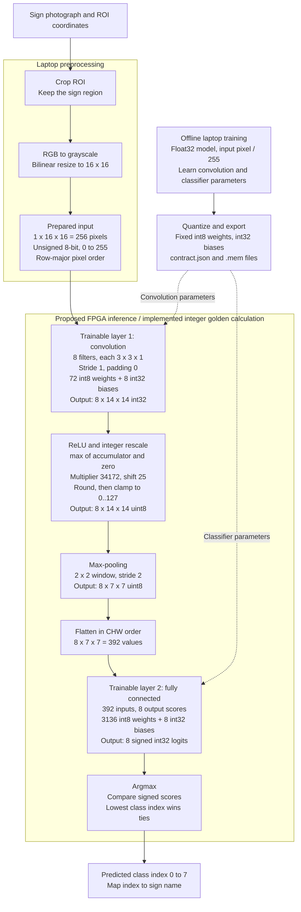

# CNN system architecture

**Historical p2-int-v1 diagram.** The document-based reset is recorded in
../DOCUMENT_BASELINE.md. Architecture shapes remain relevant, but preprocessing,
arithmetic and future class mapping must follow the new reviewed baseline.

Current candidate: 16x16 grayscale, eight sign classes, numerical contract p2-int-v1.
Python training and integer simulation are implemented. The FPGA stages below
describe the intended RTL behavior; hardware implementation is not yet verified.

## Layer count

There are **two trainable layers**: convolution and fully connected. ReLU/rescale,
pooling, flatten and argmax are processing stages without learned parameters.
Counting those operators gives six inference stages after the input, but only
two learn weights. The FPGA uses fixed exported parameters; it does not train.

## Tensor and parameter summary

| Stage | Output shape | Format | Learned parameters |
|---|---|---|---:|
| Prepared input | 1 x 16 x 16 | uint8, 0..255 | 0 |
| Convolution | 8 x 14 x 14 | int32 accumulator | 72 weights + 8 biases |
| ReLU and rescale | 8 x 14 x 14 | uint8, 0..127 | 0 |
| Max-pool | 8 x 7 x 7 | uint8, 0..127 | 0 |
| Flatten | 392 | uint8, CHW order | 0 |
| Fully connected | 8 | int32 logits | 3136 weights + 8 biases |
| Argmax | One class index | uint8 storage, valid values 0..7 | 0 |

Total: **3,208 weights + 16 biases = 3,224 learned parameters**.
Integer parameter storage: 3,208 weight bytes + 64 bias bytes = **3,272 bytes**,
excluding scale metadata. Inference requires 17,248 MACs, excluding bias adds,
pooling, rescaling and memory/control overhead; this is not measured latency.

Each filter produces 196 responses before pooling and 49 after pooling.
These are spatial responses to a learned filter, not 196 distinct feature types.

## Exact arithmetic and input notes

- Valid convolution output side: (16 - 3) / 1 + 1 = 14.
- Requantization: min(127, (max(0,A)*34172 + 16777216) >> 25).
- Rescale intermediates are int64 under the current contract. MAC accumulators
  and scores are int32; overflow is forbidden and checked against bounds.
- Parameters are fixed from training; convolution filters are learned too.
- Histogram equalization is not part of this trained baseline.
- Float training uses pixels divided by 255; integer inference receives raw
  prepared bytes and accounts for scale in the quantization parameters.
- Softmax is not needed on the FPGA to choose the largest score.
- Preprocessing assumes a supplied ROI. Automatic sign detection, live camera
  capture, UART framing and display wiring are outside this implemented baseline.

## Class mapping

| Model index | GTSRB ID | Sign |
|---|---|---|
| 0 | 1 | Speed limit 30 |
| 1 | 2 | Speed limit 50 |
| 2 | 12 | Priority road |
| 3 | 13 | Yield |
| 4 | 14 | Stop |
| 5 | 17 | No entry |
| 6 | 18 | General caution |
| 7 | 38 | Keep right |

Source of truth: reference_model/model.py, golden.py and
models/p2-int-v1/contract.json. See P2_to_RTL_Handoff.docx for memory addresses,
signedness guidance, file loading and RTL verification steps.
