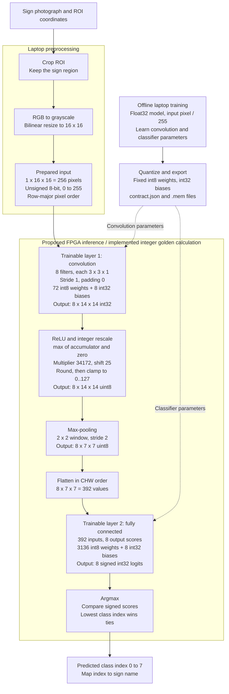

# Hasil eksperimen model

Metrik berikut adalah catatan eksperimen bertanggal. Status integrasi terbaru
ada di [panduan proyek](../../docs/README.md#status-proyek); klaim pending/tes
pada catatan lama menggambarkan waktu eksperimen tersebut.


## Kuantisasi C-43

Profil C memakai input 16×16, 16 filter, dan FC 784 → 43 dengan
61.936 MAC per citra. Ketiga checkpoint dievaluasi pada 7.830 citra
validasi dari cache training yang sama. Kalibrasi maksimum aktivasi ReLU
hanya memakai 31.379 citra training. SHA256 split
`2c48fdcea2c4d4aaabdb16118f98d88a00fc8b131449ccb28de4a8a2fea76d01`.

| Seed | Akurasi float | Akurasi integer | Recall integer Speed 30 | Prediksi berubah |
|---|---:|---:|---:|---:|
| 42 | 91,62% | 91,75% | 88,00% | 113 |
| 43 | 92,09% | 92,11% | 89,11% | 103 |
| 44 | 92,49% | 92,52% | 92,44% | 82 |
| Rata-rata | 92,07% | 92,12% | 89,85% | |

Recall makro rata-rata tetap 91,80% setelah pembulatan. Recall integer
terendah pada ID GTSRB 20 (65,56%), 21 (67,22%), dan 27 (75,56%).
Untuk seed 44, requant Conv memakai M=38660 dan S=24. Batas absolut
partial sum terbesar pada ketiga seed adalah 835.898, di bawah batas
signed24 sebesar 8.388.607. Oracle serial cocok untuk satu citra
validasi per kelas pada tiap seed (129 pemeriksaan).

```powershell
python reference_model/document_v2/quantize_experiments.py --runs <run-C-43> --shared-split build/model_studio/split_manifest_43.json --output build/model_studio/quantized/c43
```

Output lokal memuat parameter integer, file memori, skor validasi dan
confusion matrix 43×43 untuk tiap seed.

### Official test C-43 seed 44

Checkpoint dan parameter integer dipilih berdasarkan validasi sebelum
evaluasi official test. Evaluator memakai ROI dari `Test.csv` dan
preprocessing document-v2 yang sama, tanpa augmentasi atau kalibrasi ulang.

| Model | Benar / total | Akurasi | Recall makro | Recall Speed 30 | Recall Speed 50 |
|---|---:|---:|---:|---:|---:|
| Float | 11.311 / 12.630 | 89,56% | 86,40% | 94,17% | 87,73% |
| Integer | 11.317 / 12.630 | 89,60% | 86,52% | 92,92% | 91,07% |

Model integer mencapai 92,52% pada validasi dan 89,60% pada official test.
Recall integer terendah ada pada ID GTSRB 27 (31,67%), 30 (54,00%),
dan 0 (61,67%). Kuantisasi mengubah 202 prediksi dibanding float.

Identitas SHA256 checkpoint `54ecdb431203b31a6f4ddd95a99d106161cd8545d2c83fca82a05023a62bddab`,
parameter integer `8527f1289204aaaaf684b6bbbd8bf14555090ce984393766173057512ae29a2b`,
dan `Test.csv` `7d67912235e4570d19fb6bc96e9b227b4d89e4cd2ed47e14b8e8d976e1eb82b1`.
Perintah reproduksi dan cakupan simulasi ada di
[panduan tes C-43](../../tests/README.md#datapath-c-43-seed-44).

## Kuantisasi arsitektur C/D

Enam checkpoint Model Studio dari source training `e6fcf12c` dievaluasi
dengan split per track yang sama. SHA256 split:
`efba82b434141687554baa9826f9da2658f3e05f55aefe8dfb0a53fb7944f03a`.
Cache piksel C dan D memiliki hash identik. Kalibrasi maksimum ReLU tiap
Conv memakai 11.130 gambar train, evaluasi memakai 2.760 gambar validation
per seed. Confusion matrix float tiap checkpoint cocok dengan hasil training.

| Profil / seed | Float accuracy | Integer accuracy | Integer recall Speed 30 |
|---|---:|---:|---:|
| C / 42 | 97,39% | 97,39% | 90,22% |
| C / 43 | 97,43% | 97,43% | 91,56% |
| C / 44 | 97,64% | 97,46% | 88,22% |
| D / 42 | 97,28% | 97,25% | 93,11% |
| D / 43 | 97,25% | 97,32% | 92,44% |
| D / 44 | 97,39% | 97,10% | 90,00% |

Rata-rata integer C **97,43%** (turun 0,06 poin) dan D **97,22%**
(turun 0,08 poin). D mencapai recall minimal 90% untuk semua kelas pada
ketiga seed. C memiliki akurasi rata-rata lebih tinggi dan 34.496 MAC/gambar
dibanding D 45.472. D seed 42 memiliki recall Speed 30 tertinggi di D.

Bobot int8 simetris per layer, bias/partial sum signed24, dan requantization
ReLU 0–127 dengan intermediate signed48. D menjalankan Conv kedua ber-padding
nol setelah pooling dengan skala terpisah. Batas absolut terbesar untuk
partial sum C adalah 1.690.644 dan D 789.953. Oracle Python serial memeriksa
akumulator, aktivasi dan skor pada delapan gambar per checkpoint.

```powershell
python reference_model/document_v2/quantize_experiments.py --runs <run-C> <run-D> --shared-split <split_manifest.json> --output build/quantization/cd-validation
```

Output eksperimen menyimpan `summary.json`, parameter NPZ/MEM, logit/skor
validation, confusion matrix, skala, batas dan hash checkpoint per seed.
Artefak ini dievaluasi di software. Official test, implementasi RTL C/D,
dan uji FPGA C/D belum dilakukan.

## Document v2

Completed on 2 November 2026. Implements the pictured document with explicit choices in document_v2/README.md. This is a review candidate, not team-approved RTL or final test evidence.

### Training log

| Run | Epochs run | Best epoch | Validation accuracy | Training accuracy (no augmentation at evaluation) |
|---|---:|---:|---:|---:|
| Seed 42 | 60 | 54 | 96.92% | 98.34% |
| Seed 43 | 60 | 54 | 96.81% | 98.22% |
| Seed 44 | 60 | 59 | 96.16% | 97.92% |

Per-epoch histories/configs/metrics: training_logs/document_v2/. Three seeds share the original physical-sign split: 11,130 training images and 2,760 validation images. Class indices changed to the document-listed order. All runs used equalization and training-only augmentation; see saved configs.

### Integer simulation

Selected float accuracy: 96.92%; int24 accuracy: 96.63%; decrease: 0.290 percentage points.
Prediction agreement: 99.53%; 13 changed predictions. Activation saturation count: 0 / 4,327,680.

| Class | Float recall | Integer recall |
|---|---:|---:|
| Stop | 98.00% | 98.00% |
| Yield | 99.52% | 99.52% |
| No entry | 98.10% | 98.57% |
| Priority road | 98.81% | 98.57% |
| General caution | 99.17% | 99.17% |
| Keep right | 98.81% | 98.81% |
| Speed limit 30 | 87.33% | 85.56% |
| Speed limit 50 | 98.44% | 98.44% |

### Interpretation and feedback

The document 95% overall threshold is met on validation. The official test gate is still pending. The old additional 90%-recall-per-class working criterion is not met: speed-limit 30 integer recall is 85.56%. This weakness must remain visible; the overall accuracy does not establish good performance on every class.
The new pipeline changes equalization, augmentation, class-row order and training budget, so differences from the historical 97.50% result cannot be attributed to equalization alone. Do not restore the old model as compliant or silently drop equalization.
Recommendation: review speed-limit confusion and the numerical/memory contract with the team. Keep the current candidate versioned. Any augmentation or optimizer improvement should be a new experiment on validation data before official-test evaluation; do not tune against the final test set.

### Arithmetic and exports

Contract p2-doc-int-v2: signed 24-bit biases/accumulators/scores, weights -127..127, uint8 pixels, activation 0..127 in uint8 storage, signed 48-bit rescale. M=43980, S=25.
Bounds: conv 167,442; FC 752,322; widened rescale 7,380,876,376.
Calibration uses only training images. Parameter rounding is nearest ties to even; positive activation rescaling rounds nearest with halfway upward. MAC overflow is forbidden.
25 vectors (20 real, five synthetic) matched the independent serial oracle at all stages. Eleven automated checks passed initially; additional published-export validation is in tests/test_document_v2.py.

Shared package: reference_model/models/p2-doc-int-v2/. Contains 156 .mem files, six .coe files, params.vh, numerical contract, parameters.npz, metrics, 25 vector folders, 16-image stored bank, labels, source manifest and checksums.
24-bit memory words have six hex digits in two's complement. The .npz container may use a wider NumPy dtype; checked logical widths remain 24-bit. Model parameters and source scripts are Git-visible, not committed/pushed by this work.

### Remaining work

P1/P3/P4 contract review; P5 31-byte protocol and UI migration; model/ROM integration; RTL numerical simulation; board tests; final official-test accuracy. params.vh compilation checks syntax/constants only and is not CNN RTL verification. No board cycles or 0.2 ms latency are claimed.

## Baseline v1

The 16x16 model is a viable leading float candidate for these eight classes. Across three seeds it averages 97.05% validation accuracy, versus 96.78% for 32x32. The small difference does not establish statistical superiority. All six runs meet the proposed overall and per-class targets on this single grouped split.

Keep 16x16 as the working candidate because the larger model did not provide a clear benefit in this experiment. Do not freeze hardware yet: inspect the speed-limit errors and measure integer quantization degradation first. Some runs still improved near epoch 40, so these are baseline results rather than fully optimized models.

The selected subset passed all image readability, dimensions and ROI checks: 13,890 images, split into 11,130 training images from 371 tracks and 2,760 validation images from 92 tracks. Other classes have not undergone these checks. The official test set was not opened.

Four automated checks passed for grouping, cropping, dimensions and cost calculations. Checkpoints, split manifest, raw metrics and plots are local in build/reference_model/baseline_v1/. They are ignored by Git. Reproduction instructions are in reference_model/README.md.

# Float CNN validation experiment

Training data: eight selected GTSRB classes. Official test data was not used.
Split: stratified by class at physical-sign track level; split seed 2026.
Preprocessing: inclusive ROI crop, Pillow grayscale, bilinear resize, divide by 255.
Training: Adam, class-weighted cross entropy, no augmentation or histogram equalization.
Each run selects its best validation-accuracy checkpoint. Results are exploratory validation estimates.
The 32x32 model has more classifier parameters, so this is not a pure resolution-only ablation.

| Size | Seed | Epoch | Train accuracy | Validation accuracy | Macro recall | Minimum class recall | Proposed gate |
|---|---|---|---|---|---|---|---|
| 16 | 42 | 39 | 98.31% | 97.50% | 97.70% | 92.89% | Pass |
| 16 | 43 | 36 | 97.92% | 97.32% | 97.60% | 92.00% | Pass |
| 16 | 44 | 39 | 97.16% | 96.34% | 96.60% | 93.11% | Pass |
| 32 | 42 | 29 | 98.52% | 96.74% | 97.06% | 92.67% | Pass |
| 32 | 43 | 39 | 98.72% | 96.38% | 96.72% | 91.78% | Pass |
| 32 | 44 | 39 | 98.50% | 97.21% | 97.37% | 95.78% | Pass |

### Per class validation recall

| Class | 16 seed 42 | 16 seed 43 | 16 seed 44 | 32 seed 42 | 32 seed 43 | 32 seed 44 |
|---|---|---|---|---|---|---|
| Speed limit 30 | 92.89% | 92.00% | 93.11% | 92.67% | 91.78% | 95.78% |
| Speed limit 50 | 99.33% | 99.56% | 95.78% | 97.33% | 97.56% | 96.22% |
| Priority road | 96.67% | 97.62% | 96.43% | 97.38% | 95.24% | 96.43% |
| Yield | 97.38% | 96.43% | 95.71% | 94.76% | 95.48% | 96.90% |
| Stop | 96.67% | 98.00% | 96.67% | 97.33% | 96.67% | 96.00% |
| No entry | 100.00% | 100.00% | 100.00% | 100.00% | 100.00% | 100.00% |
| General caution | 99.17% | 97.92% | 95.83% | 97.50% | 97.50% | 98.33% |
| Keep right | 99.52% | 99.29% | 99.29% | 99.52% | 99.52% | 99.29% |

### Repeated seed summary

16x16: 3 runs, mean accuracy 97.05%, population SD across seeds 0.51%.
32x32: 3 runs, mean accuracy 96.78%, population SD across seeds 0.34%.

Working targets: at least 95% validation accuracy and 90% recall in every selected class. These are proposed project criteria, not lecturer requirements.
Seed variation does not measure uncertainty across new sign tracks. No integer accuracy or FPGA latency has been measured.
Before architecture freeze, review mistakes and quantization degradation. Keep the official test split reserved until decisions are frozen.

## Integer v1

The provisional p2-int-v1 contract passes the proposed quality gates on the
existing validation split. It quantizes the 16x16 seed 42 float checkpoint
without retraining. Calibration uses 11,130 training images only; evaluation
uses 2,760 validation images. The official test set remains untouched.

| Metric | Result |
|---|---|
| Float accuracy | 97.50% |
| Integer accuracy | 97.50% |
| Accuracy drop | 0.00 percentage points |
| Prediction agreement | 99.67% |
| Changed predictions | 9 / 2,760 |
| Integer minimum class recall | 93.56% |
| Validation activation clipping above 127 | 0 / 4,327,680 values |
| Independent scalar oracle | 25 / 25 vectors matched at every stage |

### Per class validation recall

| Class | Float | Integer |
|---|---|---|
| Speed limit 30 | 92.89% | 93.56% |
| Speed limit 50 | 99.33% | 99.11% |
| Priority road | 96.67% | 96.67% |
| Yield | 97.38% | 97.14% |
| Stop | 96.67% | 96.67% |
| No entry | 100.00% | 100.00% |
| General caution | 99.17% | 99.17% |
| Keep right | 99.52% | 99.29% |

### Contract and feedback

Weights are symmetric signed 8-bit with one scale per layer. Inputs are uint8,
activations are restricted to 0..127, MAC accumulators and scores are int32,
and rescale intermediates are int64. Overflow is forbidden. Parameter rounding
uses nearest ties to even; positive activation rescaling rounds nearest with
halfway upward. Actual rescale multiplier M = 34,172 and shift S = 25.

Conservative absolute partial-sum bounds are 181,902 for convolution and
610,764 for the classifier. The rescale bound including rounding is
6,232,732,360. These bounds cover any valid input bytes and any allowed pooled
activations for these fixed parameters, rather than only observed images.

Recommendation: review this contract with the RTL owners. The int64 rescale is
deliberately conservative. These fixed weights require only 34 signed bits to
represent the proven nonnegative rescale bound, but narrowing the contract
requires a corresponding specification revision and verification. Retain the
documented widths until the team agrees a change.

Identical total accuracy does not mean identical predictions or logits. Nine
predictions changed. The remaining speed-limit confusion persists, so
quantization has not solved recognition errors. Float and integer scores are
not expected to match exactly; dequantized logit mean absolute error is 0.18536.

Eight automated tests pass for grouping, cropping, layer dimensions, cost
calculations and integer arithmetic. The arithmetic cases cover halfway
rounding, ReLU, clipping, zero shift, signed overflow rejection, CHW pooling/FC
ordering, ties and hexadecimal encoding. The vectorized golden model also
matches an independently looped Python integer MAC oracle on 20 real images
and five synthetic inputs. Exported memory words round-trip exactly.

These are validation results from one selected checkpoint on one grouped split,
not independent final test results or a guarantee of deployment performance.

### Reproduction and artifacts

See [the contract](../README.md#historical-integer-contract-v1). From the repository root:

```powershell
python -m pytest reference_model/tests -q
python reference_model/quantize.py
```

Use a fresh --output directory to repeat without overwriting an existing run.
Checkpoints must be trusted local files.

Local output directory: build/reference_model/integer_v1/. It contains
contract.json, parameters.npz, metrics.json, validation_outputs.npz,
predictions.csv, MEMORY_LAYOUT.md, checksums.json, mem/ and vectors/. There are
154 .mem files: four parameter files and six files for each of 25 vectors.
All arrays have explicit layouts and word widths. A preserved split manifest
and hashes identify the source model and sample ordering.

The .mem files can feed readmemh subject to RTL interface agreement. They are
local build outputs, ignored by Git, and still need packaging for team delivery.

RTL simulation, board tests, UART integration, a final team-approved release,
and held-out test evaluation remain pending. Scalar oracle tests are software
arithmetic simulation, not RTL simulation.

## Training log v1

<!-- TRAINING_LOG:START -->
Source experiment: baseline_v1. Records copied from actual saved run histories; no training was rerun.

An epoch is one pass over the training set. Each run saved the checkpoint with the highest validation accuracy, which can precede the final epoch.

| Model/run | Epochs run | Best checkpoint epoch | Validation accuracy | Run time (s) | Epoch history |
|---|---:|---:|---:|---:|---|
| size_16_seed_42 | 40 | 39 | 97.50% | 11.88 | [CSV](training_logs/baseline_v1/size_16_seed_42/history.csv) |
| size_16_seed_43 | 40 | 36 | 97.32% | 10.79 | [CSV](training_logs/baseline_v1/size_16_seed_43/history.csv) |
| size_16_seed_44 | 40 | 39 | 96.34% | 10.74 | [CSV](training_logs/baseline_v1/size_16_seed_44/history.csv) |
| size_32_seed_42 | 40 | 29 | 96.74% | 33.98 | [CSV](training_logs/baseline_v1/size_32_seed_42/history.csv) |
| size_32_seed_43 | 40 | 39 | 96.38% | 33.48 | [CSV](training_logs/baseline_v1/size_32_seed_43/history.csv) |
| size_32_seed_44 | 40 | 39 | 97.21% | 33.48 | [CSV](training_logs/baseline_v1/size_32_seed_44/history.csv) |

### Selected model supplied to RTL

The provisional p2-int-v1 integer package derives from **size_16_seed_42**, trained for **40 epochs**, using the best checkpoint at **epoch 39**.
Quantization used training-only calibration and **zero additional training epochs**. It did not train a second neural network or use quantization-aware training.
See the shared package contract.json for the selected checkpoint hash. All source checkpoint hashes are recorded in the summary CSV.

### What each per-epoch CSV contains

- epoch: completed training epoch number.
- train_online_accuracy: training predictions collected while optimizer updates were occurring; this is not a separate evaluation of the final checkpoint.
- validation_accuracy: accuracy after that epoch, with inference mode and no optimizer updates.
- validation_loss: unweighted validation cross entropy after that epoch.

Each run folder also contains the original config.json and metrics.json. The latter includes training-set evaluation and per-class validation recall for the selected checkpoint.

### Shared training settings

Adam, learning rate 0.001, batch size 128, maximum 40 epochs, patience 12 epochs without improved validation accuracy. All six runs reached epoch 40. Class-weighted training loss, no augmentation or histogram equalization. Same grouped sign-track split, split seed 2026, initialization seeds 42/43/44. See each config.json for exact environment and split identity.

Reported run time includes training plus selected-checkpoint evaluation; it excludes dataset decoding/preparation and is not FPGA inference latency.
The official test set was not used. Accuracy comparisons are validation results; selecting a best epoch uses validation information.

### Refresh the log

From repository root:

```powershell
python reference_model/export_training_log.py
```

Default source: build/reference_model/baseline_v1/. Default destination: reference_model/results/. The exported records are Git-visible; source checkpoints and caches remain ignored.
<!-- TRAINING_LOG:END -->

## Historical system diagram v1

**Historical p2-int-v1 diagram.** The document-based reset is recorded in
../README.md#baseline-dan-keputusan. Architecture shapes remain relevant, but preprocessing,
arithmetic and future class mapping must follow the new reviewed baseline.

Current candidate: 16x16 grayscale, eight sign classes, numerical contract p2-int-v1.
Python training and integer simulation are implemented. The FPGA stages below
describe the intended RTL behavior; hardware implementation is not yet verified.



### Layer count

There are **two trainable layers**: convolution and fully connected. ReLU/rescale,
pooling, flatten and argmax are processing stages without learned parameters.
Counting those operators gives six inference stages after the input, but only
two learn weights. The FPGA uses fixed exported parameters; it does not train.

### Tensor and parameter summary

| Stage | Output shape | Format | Learned parameters |
|---|---|---|---:|
| Prepared input | 1 x 16 x 16 | uint8, 0..255 | 0 |
| Convolution | 8 x 14 x 14 | int32 accumulator | 72 weights + 8 biases |
| ReLU and rescale | 8 x 14 x 14 | uint8, 0..127 | 0 |
| Max-pool | 8 x 7 x 7 | uint8, 0..127 | 0 |
| Flatten | 392 | uint8, CHW order | 0 |
| Fully connected | 8 | int32 logits | 3136 weights + 8 biases |
| Argmax | One class index | uint8 storage, valid values 0..7 | 0 |

Total: **3,208 weights + 16 biases = 3,224 learned parameters**.
Integer parameter storage: 3,208 weight bytes + 64 bias bytes = **3,272 bytes**,
excluding scale metadata. Inference requires 17,248 MACs, excluding bias adds,
pooling, rescaling and memory/control overhead; this is not measured latency.

Each filter produces 196 responses before pooling and 49 after pooling.
These are spatial responses to a learned filter, not 196 distinct feature types.

### Exact arithmetic and input notes

- Valid convolution output side: (16 - 3) / 1 + 1 = 14.
- Requantization: min(127, (max(0,A)*34172 + 16777216) >> 25).
- Rescale intermediates are int64 under the current contract. MAC accumulators
  and scores are int32; overflow is forbidden and checked against bounds.
- Parameters are fixed from training; convolution filters are learned too.
- Histogram equalization is not part of this trained baseline.
- Float training uses pixels divided by 255; integer inference receives raw
  prepared bytes and accounts for scale in the quantization parameters.
- Softmax is not needed on the FPGA to choose the largest score.
- Preprocessing assumes a supplied ROI. Automatic sign detection, live camera
  capture, UART framing and display wiring are outside this implemented baseline.

### Class mapping

| Model index | GTSRB ID | Sign |
|---|---|---|
| 0 | 1 | Speed limit 30 |
| 1 | 2 | Speed limit 50 |
| 2 | 12 | Priority road |
| 3 | 13 | Yield |
| 4 | 14 | Stop |
| 5 | 17 | No entry |
| 6 | 18 | General caution |
| 7 | 38 | Keep right |

Source of truth: reference_model/model.py, golden.py and
models/p2-int-v1/contract.json. See P2_to_RTL_Handoff.docx for memory addresses,
signedness guidance, file loading and RTL verification steps.
